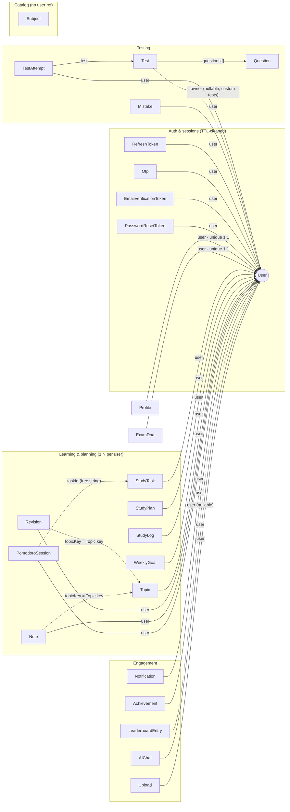

# Module 3.4 — Data Modeling & Performance

> **Goal:** See the database as a *designed system*: why each of your ~25 models embeds or references, the full relationship map of the app, how indexes make user-scoped queries fast, a working introduction to the aggregation pipeline, and where Redis fits next to MongoDB.

---

## Concepts

### The one question of document modeling: embed or reference?

SQL forces normalization (everything in its own table, joined at read time). Mongo gives you a choice per relationship:

- **Embed** — the child data lives *inside* the parent document (subdocuments, Module 3.2).
- **Reference** — the child is its own document in another collection, linked by a stored ObjectId (+ `populate`, Module 3.3).

The deciding heuristics — each mapped to a real choice in `backend/src/models/`:

| Ask | If yes → embed | Real embed in your app | If no → reference | Real reference |
|---|---|---|---|---|
| Is the child *only ever* read with the parent? | ✅ | `TestAttempt.responses` — a response is meaningless without its attempt | Child queried on its own? → ref | `Mistake` — listed/filtered/paged independently of any attempt |
| Is the list bounded and modest? | ✅ | `User.authProviders` — at most a couple of providers | Unbounded growth? → ref | `StudyTask` — tasks accumulate for years; docs have a 16 MB cap and big docs are slow |
| Do you want atomic updates of parent+child? | ✅ | `attempt.responses.set(...); attempt.save()` — one atomic doc write | Shared by many parents? → ref | `Question` — one question appears in many `Test`s; embedding would duplicate it |
| Is the child's lifecycle the parent's lifecycle? | ✅ | `AIChat.messages` — delete the chat, messages go with it | Independent lifecycle? → ref | `Test` vs `TestAttempt` — attempts outlive test edits, tests outlive attempts |

Every embedded structure in your app, catalogued: `User.authProviders` · `TestAttempt.responses` + `subjectBreakdown` · `StudyPlan.days` (which itself embeds `items` — two levels!) · `AIChat.messages` · `ExamDNA.radar`/`behaviours`/`errorProfile` · `Upload.parsed` · `Profile.settings`.

And a third option SQL people forget: **duplicate on purpose (denormalize)**. `LeaderboardEntry` stores `name`, `institute`, `state` *copied* from User/Profile rather than referencing them — so rendering a leaderboard page requires zero populates of hundreds of users. Cost: rename yourself and old entries keep the old name until something rewrites them. Mongo culture: *optimize for the read path you actually have; accept managed duplication.*

A fourth, softer pattern in your app: **string-key links**. `Revision.topicKey` and `Note.topicKey` hold `Topic.key` (a slug like `"rot"`), not an ObjectId; `PomodoroSession.taskId` is a free-form string that "can reference either a StudyTask id or a client-side task key" (its own doc comment). Looser than refs — no populate, no integrity at all — appropriate when the link is informational, not structural.

### Why *split* User and Profile at all?

`Profile` is 1-to-1 with `User` (`user: { ..., unique: true }`) — so why two collections? The doc comment in `profile.model.js` answers: *"separate collection to keep the auth document lean and to normalize the ever-growing set of learning/stat fields."* The User doc is loaded on **every authenticated request** (`middlewares/authenticate.js` resolves the JWT to a user); XP, streaks, and settings are only needed on some pages. Small hot documents, fat cold documents. Same reasoning for `ExamDNA` (also unique-per-user): a chunky analytics blob you only load on analytics pages.

### The relationship map

Built by reading every file in `backend/src/models/`. Solid arrows = ObjectId refs; the User hub is grouped by domain to stay readable:



How to read it:

- **User is the hub.** 21 of 25 models point at User; 19 are strict 1-to-N ("a user's tasks/mistakes/attempts/…"), 2 are 1-to-1 (`Profile`, `ExamDna` — enforced by `unique: true` on the ref). `Test.owner` and `LeaderboardEntry.user` are *nullable* refs: platform tests and synthetic leaderboard rows have no owner.
- **The one many-to-many** is `Test ↔ Question`, expressed as `Test.questions: [ObjectId ref Question]` — an array of refs on one side (a question can sit in many tests; nothing on Question points back).
- **`TestAttempt` is the join-like entity**: it references both `user` and `test`, plus embeds its `responses` — the richest document in the app.
- **Catalog vs per-user data** is the deepest split. `Subject` and `Question` have *no* user field — shared content. Everything else is user-scoped. Interestingly `Topic` (mastery graph) *is* per-user even though topics sound catalog-ish — because `mastery`, `weakQuestions`, `lastRevisedAt` are personal state.
- Dotted lines are the soft string-key links described above — no populate possible, integrity by convention only.

### Indexes — why every query in this app is fast

An index is a sorted lookup structure (a B-tree) on chosen fields. Without one, `find({ user: userId })` **scans the whole collection** — fine at 100 docs, catastrophic at 10 million. With one, MongoDB walks the tree in ~log(n) steps to exactly the matching range.

The design rule your app follows everywhere: **index what you filter and sort by, together, in that order.** Since virtually every query is scoped `{ user: userId, ... }` (both a security invariant — Module 3.3 — and a performance one), `user` leads almost every index. The real index inventory, by intent:

| Index (file) | Serves which real query |
|---|---|
| `{ user: 1, date: 1 }` — studyTask | `StudyTask.find({ user, date: day })` (tasks + dashboard) |
| `{ user: 1, date: 1 }, { unique: true }` — studyLog | Heatmap reads **and** enforces one log per user per day — an index as a *business rule* |
| `{ user: 1, createdAt: -1 }` — testAttempt, pomodoroSession, upload | "This user's newest first" lists |
| `{ user: 1, status: 1, category: 1 }` — mistake | `listMistakes` filter combos |
| `{ user: 1, updatedAt: -1 }` — aiChat · `{ user: 1, read: 1, createdAt: -1 }` — notification | Chat list; unread-inbox queries |
| `{ user: 1, topicKey: 1, revisedAt: -1 }` — revision · `{ user: 1, topicKey: 1, createdAt: -1 }` — note | Per-topic history, newest first |
| `{ user: 1, subject: 1 }` — topic · `{ user: 1, scope: 1, periodStart: 1 }` — studyPlan · `{ user: 1, weekStart: 1 }` — weeklyGoal | Per-user slices |
| `{ scope: 1, range: 1, xp: -1 }` — leaderboardEntry | The one *hot non-user* query: `find({ scope, range }).sort({ xp: -1 })` — equality fields first, sort field last, so results stream **pre-sorted** |
| `{ subject: 1, difficulty: 1 }` — question · `{ exam: 1, order: 1 }` — subject | Catalog filtering |
| Partial uniques on email/username/mobile + `{ "authProviders.provider": 1, "authProviders.providerId": 1 }` — user | Login/signup/OAuth lookups (Module 3.2) |
| `{ expiresAt: 1 }, { expireAfterSeconds: 0 }` — all 4 token models | TTL auto-purge |
| `{ question: "text", chapter: "text" }` — mistake | A **text index** for word-based search. Honest note: `listMistakes` currently searches with a regex `$or` instead (substring semantics, works without index support for mid-word matches) — the text index sits ready for a `$text` upgrade |

Two rules of thumb hiding in that table: a compound index `{ a: 1, b: 1, c: -1 }` also serves queries on `a` alone and on `a + b` (**prefix rule**) — but not on `b` alone; and indexes aren't free (each one slows every write and eats RAM), so index the queries you *have*, not the ones you can imagine.

### The aggregation pipeline

`find()` answers "which documents?" Aggregation answers "what do the documents *add up to*?" — it's a **pipeline**: documents flow through stages, each stage transforming the stream. The mental model is Unix pipes, or `Array.filter → map → reduce` executed *inside the database*.

Core stages: `$match` (filter — like find), `$group` (fold docs into summary rows — like reduce), `$sort`, `$limit`, `$project` (reshape — like map), `$sample` (random pick), `$lookup` (a join).

**The real aggregation in your codebase** — `backend/src/services/tests.service.js`, building a custom practice test by random sampling:

```js
let sampled = await Question.aggregate([
  { $match: scoped },                 // e.g. { subject: { $in: subjects } } — or {} for all
  { $sample: { size: n } },           // n random docs — randomness done IN the DB
  { $project: { _id: 1 } },           // keep only ids; we just need refs for Test.questions
]);
```

Why aggregation here? "Random n" is impossible to express with `find`, and shipping the whole question bank to Node just to shuffle it would be absurd. The `$project` also shows aggregation returning **plain objects** (like `.lean()`) — note the code reads `s._id`, not `s.id`, because no `toJSON` transform runs.

**Where your app aggregates in JS instead** — and how it would look as a pipeline. `tests.service.js` → `getStats` fetches all submitted attempts and reduces in Node (`attempts.reduce((sum, a) => sum + (a.accuracy || 0), 0) / attempted` …). Per-user that's dozens of docs — fine. But a *cross-user* leaderboard computed the same way would mean loading every attempt in the system. The pipeline version of "weekly XP-style ranking from attempts" looks like:

```js
const since = new Date(Date.now() - 7 * 24 * 3600 * 1000);
const rows = await TestAttempt.aggregate([
  { $match: { status: "submitted", submittedAt: { $gte: since } } },
  { $group: {
      _id: "$user",                          // one output row per user
      totalScore: { $sum: "$score" },
      avgAccuracy: { $avg: "$accuracy" },
      attempts:   { $sum: 1 },
  } },
  { $sort: { totalScore: -1 } },
  { $limit: 100 },
  { $lookup: {                               // join names in for display
      from: "users", localField: "_id", foreignField: "_id", as: "user",
  } },
  { $unwind: "$user" },
  { $project: { name: "$user.fullName", totalScore: 1, avgAccuracy: 1, attempts: 1 } },
]);
```

Only the top-100 summary rows ever leave the database. Your current `leaderboard.service.js` instead reads **precomputed** `LeaderboardEntry` docs — the third strategy: run the expensive aggregation *occasionally* (a background job), store results, serve reads cheaply. All three (JS-side, live pipeline, precomputed) are legitimate; the variables are data volume and freshness needs.

### Redis next to Mongo: cache & queues vs source of truth

Your app wires up a second store — Redis (`backend/src/config/redis.js`) — with a sharply different job. Redis is in-memory (microsecond reads, data loss acceptable), Mongo is on-disk (the durable record). The design comment in the file says it plainly: Redis is **OPTIONAL** — *"If it isn't configured, the app still boots — features that need it (BullMQ, distributed rate limiting, caching) simply stay dormant."*

Where it's actually used:

- **Job queues** — `backend/src/jobs/queue.js` is a BullMQ factory: `createQueue(name)` returns a Redis-backed queue (retry policy: `attempts: 3`, exponential backoff) or `null` without Redis. Queued jobs are *work in flight*, not records — losing them means retrying, not losing user data.
- **Distributed rate limiting** — `backend/src/middlewares/rateLimiter.js` uses a `RedisStore` *"when Redis is available (so limits hold across instances)"*: request counters must be shared across API replicas and are worthless after 60 s. Perfect Redis data, terrible Mongo data.
- **Caching (pattern ready, not yet used)** — e.g. cache a leaderboard page under `leaderboard:india:weekly:1` with a 60 s TTL; on miss, read Mongo, fill cache. Rule one of caching: a cache is *disposable* — flushing Redis must never lose truth.

The dividing line to internalize: **if losing it would anger a user, it's in Mongo. If losing it just costs a recomputation or a retry, Redis may hold it.** Notice both configs encode their role in failure handling: `database.js` *throws and kills boot* if Mongo is unreachable; `redis.js` logs a warning and carries on (`connectRedis` catches its own ping failure). Even error handling tells you which store is load-bearing.

---

## In your codebase

A guided tour that ties the module together — open these in order:

1. `backend/src/models/testAttempt.model.js` — embed (`responses`) and reference (`user`, `test`) in one schema, plus `{ user: 1, createdAt: -1 }`.
2. `backend/src/models/leaderboardEntry.model.js` — deliberate denormalization + the `{ scope: 1, range: 1, xp: -1 }` covering-ish index for its exact hot query.
3. `backend/src/models/studyLog.model.js` — a unique compound index as a business rule (one log per user-day).
4. `backend/src/services/tests.service.js` → `createCustomTest` — the real pipeline, and how its `_id`-only output feeds `Test.create({ questions: ids, ... })`.
5. `backend/src/config/redis.js` + `backend/src/jobs/queue.js` + `backend/src/middlewares/rateLimiter.js` — the entire Redis story in three short files.

---

## Pitfalls & gotchas

1. **Embedding unbounded arrays.** Documents cap at 16 MB, and every read/write moves the whole doc. `AIChat.messages` is the one place in your app that *could* someday hurt (a thousand-message chat) — know the escape hatch: split messages into their own collection.
2. **Denormalized copies go stale.** `LeaderboardEntry.name` won't follow a profile rename. Every denormalization needs a written answer to "what refreshes this, and how stale is acceptable?"
3. **Indexes must match query *shape*, prefix-first.** `{ user: 1, date: 1 }` does nothing for a query filtering only on `date` across all users. If you add an admin query, check it has an index path.
4. **`unique` compound indexes throw on duplicates** (`E11000`) — code writing StudyLogs must upsert, not blind-insert, for a user-day that may exist.
5. **Aggregation results are plain objects** — no virtuals, no `toJSON` transform, `_id` not `id`. Same trap as `.lean()`.
6. **`$lookup` is not a foreign key.** It joins at read time and happily joins nothing (empty array) for dangling refs — same tolerance rules as `populate`.
7. **Don't make Redis load-bearing.** The moment truth lives *only* in Redis, you've made an in-memory store your database. Your app's "optional Redis" design is the guardrail — preserve it.
8. **Precomputed views need a writer.** `LeaderboardEntry` is read by the service, seeded by `backend/src/seeds/`, but nothing in the app yet *recomputes* it from real attempts. Fine for now — but a known gap between "data shown" and "data true."

---

## Exercises

Solutions in [SOLUTIONS.md](./SOLUTIONS.md) (§ Module 3.4).

1. **(Trivial)** For each, embed or reference — and name the heuristic that decides: (a) a test attempt's per-question responses; (b) a user's mistakes; (c) the questions of a test.
2. **(Open file X)** Open `backend/src/models/studyPlan.model.js`. Describe the *two levels* of embedding, and explain why plan items don't reference `StudyTask` documents instead (what's different about a plan item vs a task?).
3. **(Open file X)** Open `backend/src/models/studyLog.model.js` and `weeklyGoal.model.js`. Both have a `{ user: 1, <date-ish>: 1 }` index but only one is `unique` — why does that difference match each model's meaning?
4. **(Concept)** Using the prefix rule, which of these queries can use `mistake.model.js`'s `{ user: 1, status: 1, category: 1 }` index? (a) `{ user }`; (b) `{ user, category }`; (c) `{ status }`; (d) `{ user, status }`. Explain the interesting case.
5. **(Read the pipeline)** In `createCustomTest`, explain what each of the three stages contributes, and why the service falls back to a *second* aggregation without `$match` when the first returns nothing. What user experience does that fallback protect?
6. **(Write a pipeline)** Write an aggregation on `Mistake` producing, for one user, rows of `{ _id: <subject>, pending: <count of status "Pending">, total: <count> }`, sorted by `pending` descending. (Hint: `$sum` with `$cond`.)
7. **(Challenging — design)** Design the background job that makes `LeaderboardEntry` real: which collections it reads, the pipeline sketch, how often it runs, how it writes entries idempotently (think: delete-and-insert vs upsert per `{ user, scope, range }`), and which parts of `profile.model.js` it would denormalize.
8. **(Challenging — systems)** Your API runs as 3 replicas. Explain concretely why in-memory rate limiting breaks (numbers welcome: limit 100 req/min), how `rateLimiter.js`'s Redis store fixes it, and why the same argument does *not* justify moving `StudyTask` storage to Redis.

---

**Done with the chapters?** Check your answers in [SOLUTIONS.md](./SOLUTIONS.md) — then the best next step is opening `mongosh` (or Compass) against your dev database and running every query from Module 3.3 by hand.
