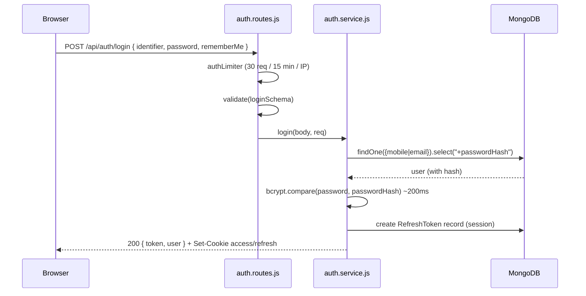

# Module 4.1 — Passwords & Hashing

> **Goal:** Understand what authentication actually is, why storing passwords is a famously dangerous problem, how bcrypt solves it, and exactly how *your* backend hashes, stores, and verifies passwords — line by line.

This module reads real code from `backend/src/`. Open the files alongside this chapter.

---

## Concepts

### Authentication vs authorization

Two words that sound alike and get confused constantly:

- **Authentication (authN)** — *"Who are you?"* Proving identity. Logging in with a password, an OTP, or a Google account is authentication.
- **Authorization (authZ)** — *"What are you allowed to do?"* Once we know who you are, deciding what you can touch. A student shouldn't see the teacher dashboard; you shouldn't be able to delete *my* tasks.

In your codebase the split is visible in `backend/src/middlewares/authenticate.js`:

- `authenticate` = authentication (verifies the token, sets `req.user`)
- `authorize("admin")` = authorization (checks `req.user.role`)

We'll dissect that file in [Module 4.2](02-jwt-and-sessions.md). This chapter is about the very first step: how the server learns your password is correct **without ever storing your password**.

### Why storing passwords is a trap

Think like an attacker for a second. The single most valuable thing in most databases isn't the app's data — it's the **password column**, because humans reuse passwords. Steal 100,000 passwords from a study app and you've probably stolen thousands of banking and email passwords too.

So the design question is: *how can the server check a password at login without keeping anything an attacker could use?* Every naive answer fails:

**Attempt 1 — store the plaintext.** `password: "ilovephysics123"` right in the database. If the DB leaks (SQL/NoSQL injection, stolen backup, malicious insider, misconfigured cloud bucket — all common), every account is instantly compromised, on your app *and* everywhere the password was reused. This is negligence, and in many jurisdictions a legal liability.

**Attempt 2 — encrypt the passwords.** Encryption is *reversible by design*: whoever has the key can decrypt. But the server needs to check passwords at login, so the key must live on the server... right next to the database it protects. An attacker who compromises the server gets both, and decrypts everything. Encryption answers "how do I get this data back later?" — which is exactly the wrong question. We *never* want the password back.

**Attempt 3 — hash with a fast hash (MD5, SHA-256).** A hash is a one-way function: `sha256("ilovephysics123") → "a91c…"`, and there's no formula to reverse it. Better! But two fatal problems:

1. **Rainbow tables / precomputation.** The same input always produces the same output. Attackers precompute hashes of billions of common passwords once, then reverse *any* leaked hash with a lookup. Also, two users with the same password have the same hash — leaking that fact alone is a problem.
2. **Speed.** SHA-256 exists to be *fast* — a single GPU computes **billions** per second. Attackers don't reverse hashes; they *guess-and-check*. Against a fast hash, an 8-character password falls in hours.

**The real answer — a slow, salted password hash.** That's bcrypt (also scrypt, argon2).

### bcrypt in depth

bcrypt fixes both problems:

**1. Built-in random salt.** Before hashing, bcrypt generates a random value (the *salt*) and mixes it in. Same password, different user → completely different hash. Rainbow tables become useless because the attacker would need a table *per salt*. The salt is not a secret — it's stored inside the hash string itself:

```
$2b$12$N9qo8uLOickgx2ZMRZoMye IjZAgcfl7p92ldGxad68LJZdL17lhWy
 │   │  └──────── salt ───────┘└───────── hash ──────────────┘
 │   └ cost factor (12)
 └ algorithm version (2b)
```

One string carries the algorithm, cost, salt, and digest. That's why your `User` model needs only one field (`passwordHash`) and no separate salt column.

**2. A tunable cost factor.** The number `12` means bcrypt internally iterates its expensive setup **2¹² = 4096** times. Each `+1` doubles the work. At cost 12, one hash takes roughly 100–300 ms on a normal server. For a user logging in once, imperceptible. For an attacker trying 10 billion guesses, catastrophic: what took seconds against SHA-256 now takes centuries. And because hardware improves, the cost factor lets defenses scale — bump `BCRYPT_SALT_ROUNDS` next decade and re-hash on next login.

**Verification without reversal.** Login doesn't decrypt anything. `bcrypt.compare(candidate, storedHash)` reads the salt and cost out of the stored hash, hashes the candidate the same way, and compares digests. Match → same password. The plaintext existed in server memory only for the duration of the request.

**Timing.** The comparison is written to take the same time whether the first byte differs or the last — a *constant-time comparison* — so an attacker can't measure response times to learn "how close" a guess was. (For bcrypt digests this is defense-in-depth rather than a practical attack vector, but it's the habit that matters: **never compare secrets with `===` byte-by-byte semantics**.)

**One quirk to know:** bcrypt only reads the **first 72 bytes** of the password. Anything longer is silently truncated. Keep this in mind — your codebase handles it, and we'll see where.

---

## In your codebase

### The hashing utility — `backend/src/utils/password.util.js`

The whole file is 36 lines. The two functions the rest of the app uses:

```js
export async function hashPassword(plainPassword) {
  return bcrypt.hash(plainPassword, env.auth.bcryptRounds);
}
```

`bcrypt.hash(plain, rounds)` — when you pass a *number* as the second argument, the library generates a fresh random salt for you and uses that cost. `env.auth.bcryptRounds` comes from `backend/src/config/env.js`:

```js
bcryptRounds: num(process.env.BCRYPT_SALT_ROUNDS, 12),
```

So: configurable via the `BCRYPT_SALT_ROUNDS` environment variable, defaulting to cost **12** — a good 2020s default.

```js
export async function verifyPassword(plainPassword, passwordHash) {
  if (!plainPassword || !passwordHash) return false;
  try {
    return await bcrypt.compare(plainPassword, passwordHash);
  } catch {
    return false;
  }
}
```

Three deliberate choices here:

1. **Guard clause** — if either input is missing (e.g., an OAuth-only user has `passwordHash: null`), return `false` instead of crashing. A missing hash must mean "wrong password," never "server error" (a distinguishable error would leak which accounts are OAuth-only).
2. **`bcrypt.compare`** — the constant-time, salt-aware check described above.
3. **`try/catch → false`** — a malformed hash in the DB also just means "no."

### Where the hash lives — `backend/src/models/user.model.js`

```js
passwordHash: {
  type: String,
  select: false,
  default: null,
},
```

**`select: false` is a big deal.** It tells Mongoose: *never include this field in query results unless explicitly asked.* Every `User.findOne(...)` across the whole codebase — profile lookups, leaderboards, the `/auth/me` endpoint — returns a user object **without** the hash. You cannot accidentally serialize it into an API response, a log line, or a websocket payload. To get it you must opt in:

```js
// backend/src/repositories/user.repository.js
async findByIdentifierWithPassword(identifier, session = null) {
  const id = String(identifier).trim();
  const match = id.includes("@") ? { email: id.toLowerCase() } : { mobile: id };
  return withSession(
    User.findOne({ ...match, ...notDeleted }).select("+passwordHash"),
    session,
  );
}
```

The `.select("+passwordHash")` (note the `+`) is the explicit opt-in, and the repository names make the intent auditable: only `findByEmailWithPassword`, `findByIdWithPassword`, and `findByIdentifierWithPassword` ever do it — i.e., only login, change-password, and delete-account flows.

There's a **second layer of defense** in the same model — the JSON transform:

```js
toJSON: {
  virtuals: true,
  versionKey: false,
  transform(_doc, ret) {
    ret.id = ret._id;
    delete ret._id;
    delete ret.passwordHash;   // ← even if it was selected, it never serializes
    delete ret.deletedAt;
    return ret;
  },
},
```

So even if some code path *did* select the hash and then `res.json(user)`-ed the document, the transform strips it. Defense in depth: two independent mistakes would be needed to leak a hash.

(Belt *and* suspenders *and* a third layer: auth responses don't serialize the Mongoose document at all — they go through `backend/src/presenters/user.presenter.js`, which builds a fresh object with an explicit allow-list of fields.)

### The signup flow — `backend/src/services/auth.service.js`

Your app's primary signup is **mobile + password + OTP** (matching the frontend spec). Walk through `signup()`:

```js
export async function signup({ name, mobile, password, exam }) {
  if (await userRepository.existsByMobile(mobile)) {
    throw ApiError.conflict("An account with this mobile number already exists.", {
      code: "MOBILE_TAKEN",
      fields: { mobile: "This mobile number is already registered." },
    });
  }

  const passwordHash = await hashPassword(password);

  const user = await withTransaction(async (session) => {
    const created = await userRepository.create(
      { fullName: name, mobile, passwordHash, exam, role: ROLES.STUDENT },
      session,
    );
    await profileRepository.create({ user: created._id, exam, ... }, session);
    await issueOtp({ user: created, purpose: "signup", mobile }, session);
    return created;
  });

  return { userId: String(user._id), otpChannel: "sms", otpExpiresInSec: OTP_EXPIRES_IN_SEC, nextStep: "verify-otp" };
}
```

Step by step:

1. **Duplicate check** — reject if the mobile is already registered. (Note: signup *deliberately* reveals "this mobile exists" — that's a product tradeoff; compare with `forgotPassword`, which reveals nothing. More on enumeration below.)
2. **`hashPassword(password)`** — the plaintext is hashed immediately; only `passwordHash` continues onward. The plaintext is never stored, never logged.
3. **A MongoDB transaction** creates the user, their profile, and their signup OTP atomically — if OTP creation fails, no half-created user is left behind.
4. The response contains **no token**. The user isn't authenticated yet — they must prove they own the phone number first (`nextStep: "verify-otp"`, covered in [Module 4.3](03-otp-verification-reset.md)).

Also note what arrives at this function: the route (`backend/src/routes/auth.routes.js`) runs `validate({ body: signupSchema })` first, and `signupSchema` in `backend/src/validators/auth.validator.js` enforces:

```js
const password = z.string().min(8, "Use at least 8 characters").max(72, "Password is too long");
```

That `.max(72)` is not aesthetic — it's the **bcrypt 72-byte truncation limit** made explicit. Without it, a user could set a 100-character password and later be surprised that any string with the same first 72 bytes also logs in.

### The login flow — `auth.service.js → login()`

```js
export async function login({ identifier, password, rememberMe = false }, req) {
  const user = await userRepository.findByIdentifierWithPassword(identifier);
  // Uniform error to avoid revealing whether the account exists.
  const invalid = () =>
    ApiError.unauthorized("Incorrect email/mobile or password.", { code: "INVALID_CREDENTIALS" });

  if (!user || !user.passwordHash) throw invalid();
  const ok = await verifyPassword(password, user.passwordHash);
  if (!ok) throw invalid();
  if (!user.isActive) throw ApiError.forbidden("This account has been disabled.");

  await userRepository.touchLastLogin(user._id);
  const tokens = await issueSession({ user, req, rememberMe });
  const profile = await profileRepository.findByUser(user._id);
  return { user: presentAuthUser(user, profile), ...tokens };
}
```

The security-relevant moves:

- **One error for every failure mode.** No such user? Same message. User exists but is OAuth-only (`!user.passwordHash`)? Same message. Wrong password? Same message. If these differed, an attacker could *enumerate* accounts ("this mobile has an account, this one doesn't") and target real users. The comment in the code says exactly this.
- **`verifyPassword` never throws** — a corrupt hash degrades to "incorrect," not to a 500 that hints something unusual exists.
- **`isActive` is checked *after* the password.** A disabled account still requires the correct password before you even learn it's disabled — otherwise "account disabled" errors would confirm accounts exist.
- Only after all checks pass does `issueSession` mint tokens (Module 4.2).

Sequence of a successful password login:



---

## Pitfalls & gotchas

1. **The signup timing tell.** `signup()` calls `existsByMobile` (fast) before `hashPassword` (slow, ~200 ms). A "mobile taken" response returns noticeably faster than a fresh signup. Combined with the explicit `MOBILE_TAKEN` error, signup *is* an enumeration surface — mitigated in this codebase by the strict `authLimiter` (30 requests / 15 min / IP), not eliminated. Almost every real product accepts this tradeoff for UX; know that you're making it.

2. **Login does not require a verified mobile.** Read `login()` again: there is no `isMobileVerified` check. A user who signed up but never completed OTP verification can still password-login. Whether that's a bug or a feature is a product decision — but you should know your code does it. (Exercise 6 explores the consequences.)

3. **`select: false` is not encryption.** Anyone with database access still sees the hashes. `select: false` protects against *your own code* leaking them through APIs — the bcrypt slowness is what protects against the DB leak itself.

4. **Password max length matters as much as min length.** Beyond the 72-byte bcrypt truncation, unbounded passwords are a DoS vector: hashing a 1 MB "password" at cost 12 burns real CPU. Your `.max(72)` plus the global `express.json({ limit: "1mb" })` body cap (see `backend/src/app.js` and `APP.JSON_BODY_LIMIT` in `constants/index.js`) bound this.

5. **Never log request bodies on auth routes.** Your morgan setup logs method/path/status — not bodies. One careless `logger.info(req.body)` in an auth controller would write plaintext passwords into `logs/`. Backups of logs leak as often as databases do.

6. **Cost factor is a dial, not a constant.** If you ever deploy on a very slow box and logins take 2 s, the fix is measuring and tuning `BCRYPT_SALT_ROUNDS` — never switching to a fast hash. And you can't re-hash stored passwords directly (you don't have the plaintexts!) — you re-hash opportunistically at each user's next successful login.

7. **OAuth users have `passwordHash: null`** (see `loginWithProvider` in `auth.service.js` — it creates users with no hash at all). The `!user.passwordHash` branch in `login()` and the guard clause in `verifyPassword` both exist for them. If you ever add "set a password" for OAuth users, it must go through `hashPassword`, never a direct write.

---

## Exercises

Answers with full explanations are in [SOLUTIONS.md](SOLUTIONS.md#module-41--passwords--hashing).

1. **In your own words:** why does *encrypting* passwords fail even if the encryption itself is unbreakable? Where exactly does the scheme break down?

2. **Read the hash.** Given a stored value `$2b$12$LJ3m4…`, identify the three pieces of information encoded before the digest, and explain why storing the salt in plain sight is safe.

3. **Code reading.** In `backend/src/repositories/user.repository.js`, list every method that selects `+passwordHash`. For each, find the calling code and state why that caller legitimately needs the hash.

4. **Threat reasoning.** Your MongoDB backup from last month leaks. Passwords are bcrypt-cost-12 hashed. Rank these user passwords from "cracked in minutes" to "effectively safe," and justify: `password123`, `Physics@2027`, `correct-horse-battery-staple-jee`, `x9$Kp2#mQ`.

5. **Timing attack thought experiment.** Suppose `verifyPassword` were implemented as `storedHash === sha256(salt + password)` using JavaScript's `===`. Describe, step by step, how an attacker *could in principle* exploit string comparison timing — and then explain why bcrypt's design makes the question mostly moot.

6. **Threat reasoning.** Because `login()` doesn't check `isMobileVerified`, describe a concrete attack where someone signs up with a phone number *they don't own*. What can they do, what can't they do, and which single line would you add to close it? What UX cost does that line introduce?

7. **Break it (safely).** Trace what happens today if an attacker POSTs `{"identifier": {"$gt": ""}, "password": "x"}` to `/api/auth/login`. Follow the request through `sanitize`, `validate(loginSchema)`, and `findByIdentifierWithPassword` — at which layer does it die, and what would happen if *each* of those layers were removed one at a time?

8. **Design question.** Signup returns `MOBILE_TAKEN`, but `forgotPassword` (Module 4.3) returns `{ sent: true }` no matter what. Both are enumeration surfaces — why is it defensible to treat them differently?

---

**Next:** [Module 4.2 — JWTs, Cookies & Sessions](02-jwt-and-sessions.md) — how the server remembers you *after* the password check, without storing sessions for every request.
