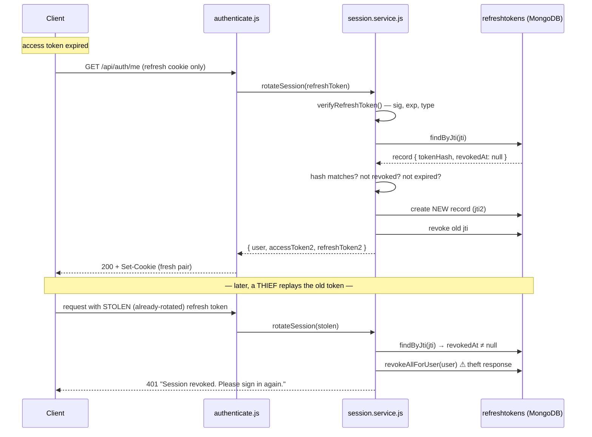

# Module 4.2 — JWTs, Cookies & Sessions

> **Goal:** Understand how a stateless server "remembers" that you logged in: JWT anatomy, signing vs encryption, the access+refresh token pattern with rotation and theft detection — then walk your codebase's `authenticate.js` line by line and dissect the session service and cookie strategy.

Prerequisite: [Module 4.1](01-password-and-hashing.md). You know how login *verifies* you. This chapter is about the next 30 days.

---

## Concepts

### The statelessness problem

HTTP has no memory. Every request arrives at the server as a stranger — nothing links request #2 to request #1. After a user logs in, how do the next 10,000 requests prove they're the same person, *without* sending the password every time?

Two classic answers:

**Server-side sessions.** On login, generate a random ID, store `{sessionId → userId}` in a DB/Redis, hand the ID to the browser in a cookie. Every request looks it up. Pros: instantly revocable. Cons: a storage lookup on *every* request, and shared state across all your server instances.

**Stateless tokens (JWT).** On login, the server writes a small signed note: *"This is user 66a…f2, role student, valid until 14:35 — signed, the server."* The client sends the note with each request; the server verifies the **signature** with math alone. No lookup, no shared state. Cons: the server can't easily "un-say" it — a signed token stays valid until it expires. **Revocation is THE weakness of JWTs**; the whole access+refresh design below exists to manage it.

Your codebase uses a hybrid that takes the best of both — stateless *access* tokens (fast) plus DB-backed *refresh* tokens (revocable). Hold that thought.

### JWT anatomy

A JSON Web Token is three base64url-encoded parts joined by dots:

```
eyJhbGciOiJIUzI1NiIsInR5cCI6IkpXVCJ9 . eyJzdWIiOiI2NmEuLi4iLCJyb2xlIjoic3R1ZGVudCIsInR5cGUiOiJhY2Nlc3MiLCJpYXQiOjE3NTQ5MDAwMDAsImV4cCI6MTc1NDkwMDkwMCwiaXNzIjoicmFua29zLmFwaSIsImF1ZCI6InJhbmtvcy5jbGllbnQifQ . dBjftJeZ4CVP-mB92K27uhbUJU1p1r_wW1gFWFOEjXk
        HEADER                                    PAYLOAD                                                                            SIGNATURE
```

- **Header** (decoded): `{"alg":"HS256","typ":"JWT"}` — which algorithm signs it.
- **Payload** (decoded): the *claims* — `sub` (subject = user id), `role`, `iat` (issued at), `exp` (expiry), `iss` (issuer), `aud` (audience), plus anything custom (your app adds `type`).
- **Signature**: `HMAC-SHA256(base64url(header) + "." + base64url(payload), secret)`.

**base64url** is just base64 with `+/` swapped for `-_` and padding dropped, so tokens survive URLs and headers. It is an *encoding*, not encryption — **anyone can decode and read a JWT's payload**. Paste one into any base64 decoder and the claims are right there. Never put secrets in a payload.

**Signed, not encrypted.** The signature doesn't hide anything; it makes the token *tamper-evident*. Change one character of the payload (say, `"role":"student"` → `"role":"admin"`) and the signature no longer matches. With **HS256** (HMAC + shared secret — what your app uses), the same secret both signs and verifies, so it must never leave the server. Think like an attacker: **the JWT secret is equivalent to every user's session at once.** Steal it and you can mint a valid token for any `sub` with any `role`. That's why `config/env.js` refuses to boot production with missing or default secrets (we'll see it).

**Expiry claims.** `exp` is a Unix timestamp; verification fails after it. Short expiry is your only built-in revocation, which forces the two-token design:

### Access + refresh tokens, rotation, and theft detection

- **Access token** — short-lived (15 min here), sent on *every* request, verified statelessly. If stolen, it's only useful briefly.
- **Refresh token** — long-lived (7–30 days here), sent *only* to the auth endpoints, and **recorded server-side**. When the access token expires, the client trades the refresh token for a fresh pair.

Because refresh tokens live in a database table, they are *revocable* — logout deletes/marks one, "log out everywhere" marks all. And because each refresh is **single-use** (using it revokes it and issues a replacement — *rotation*), you get a beautiful theft alarm:

If a token is stolen and used by both the thief and the real user, *someone* will eventually present an already-rotated (revoked) token. That event is impossible in normal operation — so the server treats it as compromise and **revokes the whole family**, forcing a re-login that locks the thief out. Your code implements exactly this; see below.

### Where does the client keep tokens?

- **`Authorization: Bearer <token>` header** — read from JS memory/localStorage. Immune to CSRF (attackers' pages can't set your headers) but exposed to **XSS**: any injected script can read localStorage and exfiltrate the token.
- **Cookies** — sent automatically by the browser. With **`httpOnly`**, JavaScript *cannot read them at all*, neutralizing XSS token theft. But "sent automatically" is also the CSRF problem — a malicious page can trigger requests that carry your cookies — hence the `sameSite` flag.

The three cookie flags that matter:

| Flag | What it does | Attack it blunts |
|---|---|---|
| `httpOnly` | JS (`document.cookie`) can't read it | XSS token theft |
| `secure` | Only sent over HTTPS | Network sniffing / downgrade |
| `sameSite=lax` | Not sent on cross-site POSTs/subresources (sent on top-level GET navigation) | CSRF |

Your backend supports **both** transports — header *and* httpOnly cookies — and we'll see why and how.

---

## In your codebase

### Signing & verifying — `backend/src/utils/jwt.util.js`

Two independent token families, two secrets:

```js
export function signAccessToken(payload) {
  return jwt.sign({ ...payload, type: TOKEN_TYPES.ACCESS }, env.auth.accessSecret, {
    expiresIn: env.auth.accessExpires,   // "15m" default
    issuer: env.auth.issuer,             // "rankos.api"
    audience: env.auth.audience,         // "rankos.client"
  });
}
```

`signRefreshToken` mirrors it with `refreshSecret`, `refreshExpires` (`"7d"` default) and a `jti` in the payload. The shared internal verifier:

```js
function verify(token, secret, expectedType) {
  let decoded;
  try {
    decoded = jwt.verify(token, secret, baseVerifyOptions);   // checks signature, exp, iss, aud
  } catch (err) {
    const message =
      err.name === "TokenExpiredError" ? "Token has expired" : "Invalid or malformed token";
    throw ApiError.unauthorized(message, { cause: err });
  }
  if (decoded.type !== expectedType) {
    throw ApiError.unauthorized("Invalid token type");
  }
  return decoded;
}
```

Three defenses packed in here:

1. **`iss`/`aud` verification** (`baseVerifyOptions`) — a token signed for some *other* app (or another service sharing a secret by accident) fails even with a valid signature.
2. **Error mapping** — every jsonwebtoken failure becomes a uniform 401. Internals never leak to the client.
3. **The `type` claim** (from `backend/src/constants/tokens.js`: `"access"` / `"refresh"`) blocks *token confusion*: a refresh token replayed as an access token — or vice versa — dies here even before you remember they also use different secrets. Two independent walls.

Config, from `backend/src/config/env.js`:

```js
auth: {
  accessSecret: process.env.JWT_ACCESS_SECRET || "dev-access-secret-change-me",
  refreshSecret: process.env.JWT_REFRESH_SECRET || "dev-refresh-secret-change-me",
  accessExpires: process.env.JWT_ACCESS_EXPIRES || "15m",
  refreshExpires: process.env.JWT_REFRESH_EXPIRES || "7d",
  ...
}
```

Yes, those are placeholder dev secrets — and `env.js` **hard-exits production boot** if `JWT_ACCESS_SECRET`/`JWT_REFRESH_SECRET` are unset *or* still match `/change-me|dev-/`. Read that block (lines ~63–94); it's a great example of failing safe at startup instead of failing open at runtime.

### Line-by-line: `backend/src/middlewares/authenticate.js`

This 83-line file guards every protected route. The whole thing, annotated:

```js
function bearerToken(req) {
  const header = req.headers.authorization;
  if (header && header.startsWith("Bearer ")) return header.slice(7).trim();
  return null;
}
```

Lines 12–16: pull `Authorization: Bearer eyJ…`. `slice(7)` drops the literal `"Bearer "` prefix; `trim()` forgives stray whitespace. No header → `null` (not an error yet — cookies get a turn).

```js
export const authenticate = asyncHandler(async (req, res, next) => {
  const token = bearerToken(req) || readAccessCookie(req);
```

Line 29: **transport resolution order** — header first, cookie fallback. This is what lets one backend serve both an SPA sending Bearer headers *and* an SSR frontend relying purely on cookies. `readAccessCookie` (from `cookie.util.js`) is just `req.cookies?.["access_token"] || null`.

```js
  if (token) {
    try {
      const decoded = verifyAccessToken(token);
      req.user = { id: decoded.sub, role: decoded.role };
      return next();
    } catch {
      // Access token invalid/expired — fall through to refresh.
    }
  }
```

Lines 30–38: the **happy path** — pure math, zero DB queries. Signature + expiry + issuer + audience + type all verified; then the request is stamped with a *minimal* identity: just `{ id, role }`. Note what `catch` does: **nothing**. A dead access token isn't a rejection — it's an invitation to try healing the session:

```js
  const refresh = readRefreshCookie(req);
  if (refresh) {
    const { user, accessToken, refreshToken, refreshMaxAgeMs } = await rotateSession(refresh, req);
    setAuthCookies(res, { accessToken, refreshToken, refreshMaxAgeMs });
    req.user = { id: String(user._id), role: user.role };
    return next();
  }

  throw ApiError.unauthorized("Authentication required");
```

Lines 40–48: the **silent refresh**. If a refresh cookie is present, rotate the session (full walkthrough next section), set brand-new cookies on *this very response*, and let the request proceed as if nothing happened. The comment in the file explains the why: the SSR frontend only ever calls `GET /auth/me`; token expiry is healed here *transparently* — the client never implements a refresh dance. Only when both transports fail does the 401 finally fly.

The file also exports:

- `optionalAuth` — same token check, but never throws and **never refreshes**; used for endpoints with public + personalized variants.
- `authorize(...roles)` — the authorization half: runs *after* `authenticate`, returns 401 if `req.user` is missing (wrong middleware order) and 403 if the role isn't allowed. 401 = "I don't know you"; 403 = "I know you, and no."

### Deep read: `backend/src/services/session.service.js`

**Issuing** (login / OTP-verify / OAuth all funnel here):

```js
export async function issueSession({ user, req, rememberMe = false }, session = null) {
  const jti = generateJti();                                   // randomUUID()
  const refreshMaxAgeMs = rememberMe ? REMEMBER_ME_TTL_MS : env.auth.refreshTtlMs;  // 30d : 7d

  const accessToken = signAccessToken(accessPayload(user));    // { sub, role, email }
  const refreshToken = signRefreshToken({ sub: String(user._id), jti });

  await refreshTokenRepository.create({
    user: user._id,
    jti,
    tokenHash: hashToken(refreshToken),                        // SHA-256, never the raw token
    userAgent: req?.headers?.["user-agent"] ?? null,
    ip: req?.ip ?? null,
    expiresAt: new Date(Date.now() + refreshMaxAgeMs),
  }, session);

  return { accessToken, refreshToken, refreshMaxAgeMs };
}
```

The DB record (see `backend/src/models/refreshToken.model.js`) stores the **`jti`** (lookup key, also inside the JWT), a **SHA-256 `tokenHash`** — the raw token is *never* persisted, so a stolen database yields nothing replayable (same principle as password hashing, but a fast hash suffices because the token has 128+ bits of entropy — nothing to "guess"). It also records `userAgent`/`ip` (a "your sessions" audit trail), `revokedAt` + `replacedByJti` (rotation bookkeeping), and `expiresAt` with a **TTL index** so MongoDB garbage-collects expired sessions automatically:

```js
refreshTokenSchema.index({ expiresAt: 1 }, { expireAfterSeconds: 0 });
```

**Rotation** — the heart of the design:

```js
export async function rotateSession(rawRefreshToken, req) {
  if (!rawRefreshToken) throw ApiError.unauthorized("Missing refresh token");

  const decoded = verifyRefreshToken(rawRefreshToken);          // 1. signature/exp/type
  const record = await refreshTokenRepository.findByJti(decoded.jti);

  if (!record || record.tokenHash !== hashToken(rawRefreshToken)) {
    throw ApiError.unauthorized("Invalid session");             // 2. exists + hash matches
  }

  if (record.revokedAt) {                                       // 3. REUSE = THEFT
    logger.warn(`[auth] refresh token reuse detected for user ${record.user} — revoking all`);
    await refreshTokenRepository.revokeAllForUser(record.user);
    throw ApiError.unauthorized("Session revoked. Please sign in again.");
  }
  if (record.expiresAt.getTime() <= Date.now()) {               // 4. server-side expiry
    throw ApiError.unauthorized("Session expired. Please sign in again.");
  }

  const user = await userRepository.findById(record.user);      // 5. user still active?
  if (!user || !user.isActive) throw ApiError.unauthorized("Account unavailable");

  const remainingMs = record.expiresAt.getTime() - record.createdAt.getTime();
  const rememberMe = remainingMs > env.auth.refreshTtlMs + 1000; // 6. preserve remember-me

  const next = await issueSession({ user, req, rememberMe });   // 7. new pair
  await refreshTokenRepository.revoke(decoded.jti, null);       // 8. burn the old one

  return { user, ...next };
}
```

Walk the checks like an attacker probing each gate:

1. Forged or expired JWT → dies at signature/`exp`/`type` verification.
2. Valid signature but the `jti` was purged, or — subtle — the **hash doesn't match**: this catches a token that shares a `jti` with a real record but isn't byte-identical (e.g., minted after a secret leak-and-rotate, or cross-environment).
3. **Reuse detection**: the token was already rotated. Legit clients never do this — so it's treated as theft, logged, and *every* session for that user is revoked. This is the lockout-the-thief mechanism from Concepts, working exactly as described.
4. DB-side expiry — enforced even if the JWT `exp` were somehow longer.
5. Banned/deleted users can't refresh their way back in.
6. Remember-me isn't stored as a flag — it's *inferred* from the original record's lifetime window, so a 30-day session keeps issuing 30-day successors.
7–8. Issue the new pair, then revoke the old.



**Revocation (logout)** — `revokeSession` decodes the token just to find its `jti`, revokes that one record, and swallows all errors: logout is idempotent; logging out with a dead token is still a successful logout.

### Cookies — `backend/src/utils/cookie.util.js` + `config/env.js`

```js
function baseOptions(maxAgeMs, path = "/") {
  return {
    httpOnly: true,
    secure: env.cookie.secure,        // COOKIE_SECURE, default: true in production
    sameSite: env.cookie.sameSite,    // COOKIE_SAME_SITE, default "lax"
    domain: env.cookie.domain,        // COOKIE_DOMAIN, default undefined (current host)
    path,
    maxAge: maxAgeMs,
  };
}
```

All three flags from Concepts, wired to env with safe defaults. Two extra touches worth savoring:

**Path-scoping the refresh cookie.**

```js
const REFRESH_COOKIE_PATH = `${env.app.apiPrefix}/auth`;   // "/api/auth"
```

`setAuthCookies` puts the access cookie on `path: "/"` (needed everywhere) but the refresh cookie on `/api/auth` only. The browser therefore *never transmits* the long-lived token to `/api/tasks` or anywhere else — it physically appears only on refresh/logout requests. Smaller exposure surface, e.g. if a request log or an error report ever captures cookies.

**Clearing must mirror setting.** `clearAuthCookies` rebuilds the same `httpOnly/secure/sameSite/domain/path` options — because browsers only delete a cookie when the identifying attributes match. A classic "logout doesn't work" bug, pre-avoided.

Also note the production guard in `env.js`: `COOKIE_SAME_SITE=none` without `COOKIE_SECURE=true` kills the boot — browsers silently drop `SameSite=None` cookies that aren't `Secure`, which yields a maddening "auth works locally, breaks in prod" bug. The config layer makes it impossible.

### Both transports at once — `backend/src/controllers/auth.controller.js`

```js
function sendSession(res, status, { user, accessToken, refreshToken, refreshMaxAgeMs }) {
  setAuthCookies(res, { accessToken, refreshToken, refreshMaxAgeMs });
  return res.status(status).json({ token: accessToken, user });
}
```

Every login-ish endpoint both **sets cookies** and **returns the access token in the body** (`{ token, user }` — the exact shape `API_SPEC.md` demands). The client may use either. Note what's *not* in the body: the refresh token. It exists only in the httpOnly, path-scoped cookie — JS never touches it.

---

## Pitfalls & gotchas

1. **A JWT payload is public.** `role`, `email`, `sub` — all readable by anyone holding the token. Your `accessPayload` keeps it minimal, and that's the discipline: claims are for *the server's* authorization decisions, not secret storage.

2. **Issue-then-revoke ordering.** In `rotateSession`, the new session is created (step 7) *before* the old `jti` is revoked (step 8). If the process died between the two, an old-but-unrevoked token would coexist with its successor — and two near-simultaneous refreshes with the same token can both briefly succeed. A tiny window, and the reuse alarm still catches sustained abuse, but notice it: distributed-systems ordering is a security property.

3. **`replacedByJti` is never populated.** The model and repository support recording which token replaced which (`revoke(jti, replacedByJti)`), but `session.service.js` calls `revoke(decoded.jti, null)`. The rotation *chain* — great for forensics after a theft alarm — isn't actually being recorded. Genuine, harmless-but-real gap; fixing it is Exercise 7.

4. **Access tokens are irrevocable for their lifetime — including after theft response.** When reuse detection nukes all refresh tokens, any *access* token issued in the last 15 minutes keeps working until `exp`. That's the accepted cost of statelessness; the 15-minute TTL is the containment. If you ever need instant kill (compromised admin), you'd add a denylist checked in `authenticate` — and pay a lookup per request.

5. **`req.user` is trusted from the token, not the DB.** The happy path never queries MongoDB — a user demoted from `admin` five minutes ago still carries `role: "admin"` in unexpired tokens. Role changes propagate at refresh time (rotation re-reads the user). Know this staleness window; keep it short via short access TTLs.

6. **`POST /auth/logout` has no `authenticate` middleware** (see `auth.routes.js`). Deliberate: logout must succeed even with a fully expired session. Safe *because* `revokeSession` only ever revokes the token the caller actually presented.

7. **`trust proxy` matters for security here too.** `app.set("trust proxy", 1)` in `app.js` makes `req.ip` the real client IP behind nginx — which is what `issueSession` records and what the rate limiter keys on. Set it wrong (trust everything) and attackers forge `X-Forwarded-For` to dodge rate limits and pollute session audit rows.

---

## Exercises

Answers in [SOLUTIONS.md](SOLUTIONS.md#module-42--jwts-cookies--sessions).

1. **Decode a token.** Take any JWT (grab one from your dev server's `Set-Cookie` or make one at jwt.io), split it on `.`, and base64url-decode the first two parts by hand (Node: `Buffer.from(part, "base64url").toString()`). List every claim your backend puts in an access token and where each is set in code.

2. **Explain to a friend:** why can everyone *read* a JWT but nobody can *change* one? And why does HS256 mean the frontend can never verify tokens itself?

3. **Threat reasoning.** An attacker steals only the **access** cookie (never the refresh cookie — remember its path scope). Enumerate precisely: what can they do, for how long, and which mechanism ends the party? Now repeat for stealing only the **refresh** cookie.

4. **Code reading.** In `rotateSession`, explain the check `record.tokenHash !== hashToken(rawRefreshToken)`. The `jti` already matched — construct a scenario where this second check is the one that saves you.

5. **Threat reasoning.** Walk the reuse-detection timeline: thief steals refresh token at 12:00, uses it at 12:05; victim's app auto-refreshes at 12:10. What exactly happens at each step, in code terms? Now reverse it (victim refreshes first, thief second) — who ends up locked out in each ordering?

6. **The `type` claim.** Suppose `jwt.util.js` dropped the `type` check *and* both token families shared one secret. Write the concrete attack a user could perform against their own account to extend their session forever. Which of the two defenses (separate secrets / type claim) alone stops it?

7. **Fix a real gap.** Modify `rotateSession` (on paper) so the old record's `replacedByJti` stores the new token's `jti`. You'll find `issueSession` doesn't return the jti — propose the minimal signature change, and say what a security engineer could reconstruct after a theft alarm that they can't today.

8. **Cookie forensics.** Your `clearAuthCookies` passes `domain`, `path`, `httpOnly`, `secure`, `sameSite` — but not `maxAge`. Why must the others match the original `Set-Cookie`, and why is `maxAge` the one attribute that *shouldn't* be repeated?

---

**Next:** [Module 4.3 — OTPs, Verification & Password Reset](03-otp-verification-reset.md) — proving you own a phone number or email, and the honest state of the frontend↔backend auth contract.
