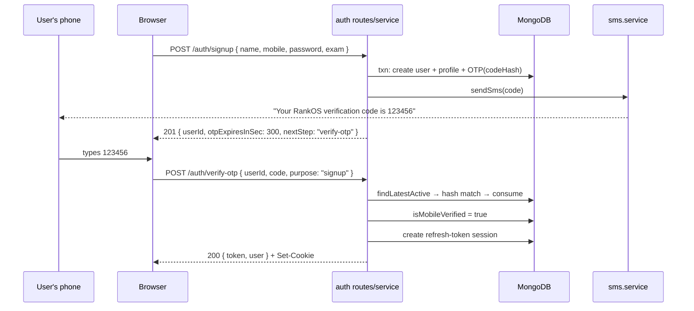

# Module 4.3 — OTPs, Email Verification & Password Reset

> **Goal:** Master "prove you own this phone/email" flows: OTP generation, hashing codes at rest, expiry, attempt limits and resend behavior — as actually implemented in your backend — plus the password-reset flow, the (unused!) email-verification model, and an honest, endpoint-by-endpoint audit of the frontend spec vs the backend reality.

Prerequisites: [Module 4.1](01-password-and-hashing.md) (hashing) and [Module 4.2](02-jwt-and-sessions.md) (sessions).

---

## Concepts

### Why OTPs exist at all

A password proves you *know a secret*. It doesn't prove the phone number you typed at signup is yours — I can sign up with *your* number and a password I invented. An **OTP (one-time password)** closes that gap: the server sends a short code to the claimed phone/email; only someone who controls that channel can echo it back. It's a *possession* proof, complementing the *knowledge* proof.

### The OTP threat model: low entropy changes everything

A 6-digit code has only **1,000,000 possibilities** (~20 bits). Compare a password-reset token with 256 random bits. This is the key insight of the whole chapter: **an OTP is guessable by brute force**, so every defense revolves around making the guessing window tiny:

1. **Short expiry** (minutes, not days) — bounds the time attackers have.
2. **Attempt limits** — bounds the number of guesses. 5 attempts against 1,000,000 codes = 0.0005% success per code. Without a limit, a script tries all million in minutes.
3. **Single-use + newest-only** — a code dies on success, and issuing a new code kills old ones, so there's never a pile of valid codes to hit.
4. **Hash at rest** — even 6-digit codes are stored hashed, so a DB peek (or a leaked backup, or an over-broad log query) doesn't hand out live codes. Note the nuance: SHA-256 of a 6-digit code *is* brute-forceable in milliseconds (only 10⁶ candidates!) — hashing here protects against *casual* exposure and honest-operator mistakes, while expiry+attempt-limits carry the real security load.
5. **Resend cooldowns & rate limits** — because *sending* is also an attack surface: SMS costs money ("SMS pumping" fraud runs up your Twilio bill against premium numbers), and unlimited resends spam real people.

### Reset links: the high-entropy cousin

Password-reset links embed a token in a URL. Unlike OTPs these can be long (no human types them), so your codebase uses **32 random bytes** (256 bits) — unguessable, therefore no attempt counter needed. But the *lifecycle* rules are identical: hash at rest, single-use, short expiry, newest-invalidates-old. And one extra rule unique to reset flows: **never reveal whether the email exists** (a reset form is the classic account-enumeration oracle).

One more property worth internalizing: **a password reset must revoke all sessions.** The #1 reason people reset passwords is "I think someone got in." If old refresh tokens survived the reset, the attacker would keep their session while the victim changes the lock on an open door.

---

## In your codebase

### Issuing an OTP — `backend/src/services/otp.service.js`

The constants first:

```js
const OTP_TTL_MS = 5 * 60 * 1000; // 5 minutes (matches API_SPEC otpExpiresInSec: 300)
const MAX_ATTEMPTS = 5;

function generateCode() {
  // 000000–999999, zero-padded → always 6 digits.
  return String(randomInt(0, 1_000_000)).padStart(6, "0");
}
```

`randomInt` comes from `node:crypto` — a **cryptographically secure** RNG. This matters: `Math.random()` is predictable (its internal state can be recovered from a few outputs), which for OTPs means an attacker who collects a few of their own codes could predict *yours*. Also note the range `[0, 1_000_000)` with zero-padding — naive code like `100000 + random*900000` would silently drop all codes starting with 0 and shrink the space by 10%.

The issue path:

```js
export async function issueOtp({ user, purpose, mobile = null, channel = "sms" }, session = null) {
  // Invalidate any outstanding codes first so only the newest is valid.
  await otpRepository.consumeAllActive(user._id ?? user, purpose, session);

  const code = generateCode();
  const expiresAt = new Date(Date.now() + OTP_TTL_MS);
  await otpRepository.create(
    { user: user._id ?? user, purpose, channel, codeHash: hashToken(code), expiresAt },
    session,
  );

  const to = mobile ?? user.mobile;
  if (to) {
    await sendSms({ to, body: `Your RankOS verification code is ${code}. It expires in 5 minutes.` });
  }
  // In non-production, also surface the code in logs for easy manual testing.
  if (!env.isProduction) {
    logger.info(`[otp] ${purpose} code for user ${user._id ?? user}: ${code}`);
  }
  return { expiresInSec: OTP_EXPIRES_IN_SEC, channel };
}
```

Walk it:

1. **`consumeAllActive` first** — the "newest-only" rule. Tap resend three times, and only the last code works. No accumulation of valid codes.
2. **`codeHash: hashToken(code)`** — `hashToken` is the SHA-256 helper from `backend/src/utils/token.util.js`. The plaintext code exists in exactly two places: the SMS message and (dev only) the server log.
3. **The dev log line is explicitly gated on `!env.isProduction`.** This is how you test signup locally with no SMS provider — watch the server console.

### The OTP record — `backend/src/models/otp.model.js`

```js
export const OTP_PURPOSES = Object.freeze(["signup", "login", "reset"]);
```

...and per-document: `user`, `purpose`, `channel` (`"sms"`/`"email"`), `codeHash`, `attempts` (default 0), `consumedAt` (null = live), `expiresAt`. Plus:

```js
otpSchema.index({ expiresAt: 1 }, { expireAfterSeconds: 0 });   // TTL: Mongo auto-deletes expired codes
otpSchema.index({ user: 1, purpose: 1, consumedAt: 1 });        // fast "newest active" lookup
```

**Purpose scoping is a real defense**, not bookkeeping: an OTP issued for `signup` can never satisfy a `reset` check because `findLatestActive(userId, purpose)` filters on purpose. Without it, any code you trick a user into requesting could be redeemed against the most damaging flow. (Honest note: of the three purposes, only `"signup"` is exercised by current routes — nothing issues `"login"` or `"reset"` OTPs today. The enum is future-proofing.)

### Verifying — the attempt-limit state machine

```js
export async function verifyOtp({ userId, purpose, code }, session = null) {
  const otp = await otpRepository.findLatestActive(userId, purpose, session);
  if (!otp) {
    throw ApiError.badRequest("Code expired or not found. Request a new one.", { code: "OTP_INVALID" });
  }
  if (otp.attempts >= MAX_ATTEMPTS) {
    await otpRepository.consume(otp._id, session);
    throw new ApiError(429, "Too many attempts. Request a new code.", { code: "OTP_LOCKED" });
  }
  if (otp.codeHash !== hashToken(String(code))) {
    await otpRepository.incrementAttempts(otp._id, session);
    throw ApiError.badRequest("Incorrect code. Please try again.", { code: "OTP_INCORRECT" });
  }
  await otpRepository.consume(otp._id, session);
  return true;
}
```

Read it as a gauntlet, in order:

1. **Is there a live code at all?** `findLatestActive` (in `otp.repository.js`) requires `consumedAt: null` *and* `expiresAt > now`, newest first. Expired → same generic `OTP_INVALID` (Mongo's TTL sweeper only runs periodically, so the query must re-check expiry itself — never trust the janitor for security).
2. **Attempt cap** — at the 6th try the code is *consumed* (permanently dead, not just rejected) and the client gets a 429. The only way forward is a fresh code.
3. **Wrong code** → `incrementAttempts` **before** returning the error, so failures always count. `String(code)` guards type juggling — hash comparison happens on a string either way.
4. **Success consumes the code** — single-use, enforced.

Do the attacker math: 5 guesses per code, each code alive ≤5 minutes, resends rate-limited (below) at 30/15 min shared across *all* auth endpoints per IP. Random guessing is hopeless.

### End-to-end: signup → OTP → session

`auth.service.js` glues it together (Module 4.1 covered `signup()` creating user+profile+OTP in one transaction). Verification:

```js
export async function verifyOtpAndLogin({ userId, code, purpose = "signup" }, req) {
  await verifyOtpCode({ userId, purpose, code });
  const user = await userRepository.findById(userId);
  if (!user || !user.isActive) throw ApiError.notFound("Account not found");
  if (!user.isMobileVerified) await userRepository.markMobileVerified(userId);
  await userRepository.touchLastLogin(userId);
  const tokens = await issueSession({ user, req, rememberMe: true });
  ...
}
```



### The SMS transport — `backend/src/services/sms.service.js` (honest status: DEV STUB)

Plain truth: **no SMS is actually sent in this build.**

```js
export async function sendSms({ to, body }) {
  if (!isProviderConfigured()) {
    // DEV STUB — never do this in production; codes must go over SMS only.
    logger.warn(`[sms:stub] → ${to}: ${body}`);
    return { delivered: false, channel: "stub" };
  }
  await sendViaProvider(to, body);   // ← throws "not implemented" even if TWILIO_* is set
  ...
}
```

`isProviderConfigured()` checks `TWILIO_ACCOUNT_SID` + `TWILIO_AUTH_TOKEN`; without them, codes go to the **server log only**. And even *with* them, `sendViaProvider` is an explicit `throw new Error("...not implemented")` placeholder. The *shape* is production-ready (single seam to swap in Twilio/MSG91); the delivery is not. Every OTP flow above works end-to-end locally because of the stub + the dev log line — just know exactly which part is real.

### Email verification — a model with no engine (honest status: UNUSED)

`backend/src/models/emailVerificationToken.model.js` exists and is textbook-correct: hashed `tokenHash`, `usedAt` for single-use, TTL-indexed `expiresAt`, same pattern as the reset token below. **But nothing uses it.** Search the codebase: there is no `emailVerificationToken.repository.js`, no service issues one, no route consumes one. The only writes to `user.isEmailVerified` are in `loginWithProvider` (OAuth users with a provider-supplied email get `isEmailVerified: true`), and `userRepository.markEmailVerified` exists with no caller. If email signup ever ships, the storage layer is ready and the flow would mirror password reset exactly — but today it's scaffolding, not a feature.

### Password reset — `auth.service.js` (fully implemented, delivery-gated)

**Request phase** (`forgotPassword`):

```js
export async function forgotPassword({ email }) {
  const user = await userRepository.findByEmail(email);
  if (user) {
    await passwordResetTokenRepository.invalidateAllForUser(user._id);
    const { token, tokenHash } = generateOpaqueToken();          // 32 random bytes + SHA-256
    await passwordResetTokenRepository.create({
      user: user._id, tokenHash,
      expiresAt: new Date(Date.now() + env.auth.passwordResetTtlMs),  // 30 min default
    });
    const link = `${env.app.clientUrl}/reset-password?token=${token}`;
    await sendMail({ to: email, subject: "Reset your RankOS password", ... });
    if (!env.isProduction) logger.info(`[auth] password reset link for ${email}: ${link}`);
  }
  return { sent: true };
}
```

The masterstroke is the shape: **`{ sent: true }` whether or not the user exists.** The `if (user)` block is invisible from outside — no enumeration oracle. (Contrast with signup's deliberate `MOBILE_TAKEN`; Exercise 8 of Module 4.1.) The token is high-entropy (256 bits — hence no attempt counter anywhere in this flow), only its hash touches the DB, and old tokens are invalidated first so only the newest link works.

**Consume phase** (`resetPassword`):

```js
const record = await passwordResetTokenRepository.findActiveByHash(hashToken(token));
if (!record) throw ApiError.badRequest("This reset link is invalid or has expired.", { code: "RESET_TOKEN_INVALID" });
const passwordHash = await hashPassword(newPassword);
await withTransaction(async (session) => {
  await userRepository.updatePassword(record.user, passwordHash, session);
  await passwordResetTokenRepository.consume(record._id, session);
});
await refreshTokenRepository.revokeAllForUser(record.user);   // force re-login everywhere
```

Lookup is *by hash* (`findActiveByHash` in the repository requires `usedAt: null` + unexpired); password-update and token-consumption are atomic in a transaction; and then **every refresh token the user owns is revoked** — the "changing the lock closes the door" property. (The revoke runs *after* the transaction, best-effort, as the code comment admits: if the process died in between, sessions would survive a reset. Small honest wart.)

Delivery caveat mirrors SMS: `backend/src/services/email.service.js` is real Nodemailer infrastructure, but if `SMTP_HOST`/`SMTP_USER` aren't configured, `sendMail` **logs and returns null** — the email is skipped. In dev you use the logged link.

---

## The frontend↔backend contract — an honest audit

History: the frontend (`rankos-ai-mentor/API_SPEC.md`, PART A) was specced for **mobile+OTP** auth while the backend foundation started life as **email/JWT primitives**. Reading today's code, that gap has been *substantially* reconciled — `auth.service.js`'s own header comment says it "orchestrates the full authentication surface documented in API_SPEC.md → PART A," and the routes now exist with matching shapes. What remains are **delivery stubs and detail drift**, itemized below. Sources: `rankos-ai-mentor/API_SPEC.md` (lines 18–89) vs `backend/src/routes/auth.routes.js` + `controllers/auth.controller.js`.

| Endpoint (spec) | Spec expects | Backend provides | Verdict |
|---|---|---|---|
| `POST /api/auth/signup` | `{name, mobile, password, exam}` → 201 `{userId, otpChannel:"sms", otpExpiresInSec:300, nextStep:"verify-otp"}` | Exactly this shape (`signup` service returns it verbatim) | ✅ Implemented — but the SMS itself is a **stub**; code appears only in server logs |
| `POST /api/auth/verify-otp` | `{userId, code, purpose}` → 200 `{token, user}` + Set-Cookie | Exactly this (`sendSession` emits `{token: accessToken, user}` + both cookies) | ✅ Implemented |
| `POST /api/auth/resend-otp` | `{userId, purpose}` → `{otpExpiresInSec: 300}`; UI shows a **28s countdown** | Endpoint matches; **no server-side cooldown** — only the shared 30-req/15-min auth limiter | ⚠️ Works, but the 28s cooldown is client-side honor system (Exercise 5) |
| `POST /api/auth/login` | `{identifier, password, rememberMe}` → `{token, user}` + Set-Cookie; "keep me signed in 30 days" | Matches; `rememberMe` → 30-day refresh window in `session.service.js` | ✅ Implemented |
| `GET /api/auth/oauth/:provider` (+ callback) | "Standard OAuth redirect flow → issues session" (Google, Apple) | **DEV STUB**: no provider credentials → mints a deterministic demo identity and short-circuits to the callback. Callback trusts `providerId`/`email` **from the query string** | 🚨 Stub — and a real vulnerability if it ever reached production unchanged (anyone could claim any email). `buildGoogleConsentUrl` sketches the real flow but the code-exchange isn't implemented |
| `POST /api/auth/forgot-password` | `{email}` → always 200 `{sent:true}`; spec says **15-min expiry** | Matches shape & enumeration-safety; TTL is **30 min** (`passwordResetTtlMs` default, and the email says "valid 30 minutes") | ⚠️ Works; TTL drifts from spec (15 vs 30 min) — pick one and align |
| `POST /api/auth/reset-password` | `{token, newPassword}` → `{reset:true}` | Matches, plus revoke-all-sessions | ✅ Implemented |
| `GET /api/auth/me` | Rich user object: `{id, role, name, initials, email, exam, examLabel, institute, state, streak}` | `presentAuthUser` in `backend/src/presenters/user.presenter.js` builds exactly this shape from User+Profile | ✅ Implemented |
| `POST /api/auth/logout` | → 204, kills session | Matches: revokes refresh token, clears both cookies, 204 | ✅ Implemented |

**Bottom line, honestly:** every PART A endpoint exists with spec-conformant shapes; the email/JWT primitives were bent into serving the mobile/OTP contract (a user can hold a mobile *or* an email *or* an OAuth identity — see the User model's partial unique indexes). What is **not** production-real: (1) SMS delivery, (2) SMTP delivery unless configured, (3) OAuth, which is a demo stub with a trust-the-query-string hole, (4) server-enforced resend cooldown, (5) the 15/30-minute reset TTL disagreement, and (6) email verification, which has a model but no flow. If you demo this app, dev logs stand in for SMS and email.

---

## Pitfalls & gotchas

1. **The OTP dev-log line is only one env var away from production.** `if (!env.isProduction)` guards it — meaning a misconfigured `NODE_ENV` on a real deployment would print every user's live OTP into log files. Startup validation (like the JWT-secret guards) is the systemic fix for this class of bug.
2. **TTL indexes are janitors, not guards.** Mongo's expiry sweep runs ~every 60s; a code can sit expired-but-present. Your queries (`findLatestActive`, `findActiveByHash`) always re-check `expiresAt: { $gt: new Date() }` — keep that habit forever.
3. **Attempt counting has a race.** `findLatestActive` then `incrementAttempts` is read-then-write: hammer the endpoint with parallel requests and several can read `attempts: 4` before any write lands, sneaking a few extra guesses past `MAX_ATTEMPTS`. The auth rate limiter (30/15 min/IP) makes this impractical here, but the airtight fix is a single atomic `findOneAndUpdate` with `attempts: { $lt: MAX }` in the filter.
4. **Resending invalidates the old code — a tiny built-in DoS.** Because `issueOtp` consumes all active codes first, anyone who can *trigger* resends for your `userId` keeps killing the code you're about to type. `userId` values aren't secret (they're in the signup response). Rate limiting is the only brake. A per-user server-side cooldown (spec's 28s) would also cap SMS spend.
5. **`verify-otp` doesn't rate-limit per *user*, only per IP.** A distributed attacker (many IPs) gets 5 guesses per code regardless — the attempt cap is the defense that doesn't care how many IPs you have. See why both layers exist?
6. **Reset links live in URLs — and URLs leak.** Browser history, referrer headers, proxy logs. Mitigations already in place: short TTL, single-use, hash-at-rest. This is also why the reset page should POST the token rather than keep it in the address bar longer than needed.

---

## Exercises

Answers in [SOLUTIONS.md](SOLUTIONS.md#module-43--otps-verification--password-reset).

1. **Entropy math.** A 6-digit OTP with 5 attempts vs an 8-char lowercase password vs a 32-byte reset token: compute the guess space of each, and explain why only the first needs an attempt counter and only the second needs bcrypt.

2. **Code reading.** In `verifyOtp`, the attempt-cap branch *consumes* the OTP before throwing 429. What specifically would go wrong if it just threw without consuming? (Hint: what does `findLatestActive` return on the next request?)

3. **Threat reasoning.** You're an attacker with the victim's `userId` and unlimited IPs (botnet). Design your best attack against `POST /auth/verify-otp` and compute your success probability per issued code. Then explain which single line of `otp.service.js` your entire attack budget is fighting against.

4. **Purpose scoping.** Construct the concrete cross-flow attack that becomes possible if `findLatestActive` ignored `purpose` — assume a future where `"reset"` OTPs exist. Who requests what, and what does the attacker redeem where?

5. **Build the missing cooldown.** The spec's 28-second resend countdown is client-side only. Sketch a server-side implementation using only the existing `Otp` schema (hint: `createdAt` of the newest record for `(user, purpose)`), including the exact error you'd return and why HTTP 429 fits.

6. **Threat reasoning — the OAuth stub.** Read `oauthCallback` in `backend/src/controllers/auth.controller.js`. Write the exact `curl`-able URL an attacker would request to obtain a session claiming `email=principal@school.edu`, and trace which code path in `loginWithProvider` makes it worse if a *real* account with that email already exists. What must the real implementation verify before trusting `email`?

7. **Reset-flow audit.** List, in order, every property of the password-reset implementation that defends against: (a) enumeration, (b) DB leak, (c) token replay, (d) an attacker already holding a session. Cite the line/function for each.

8. **Spec drift.** The spec says 15-minute reset expiry; the code ships 30 (`env.js → passwordResetTtlMs`, plus the hardcoded "valid 30 minutes" in two email strings in `auth.service.js`). List every place you'd have to touch to change the TTL cleanly, and propose the refactor that makes it *one* place.

---

**Next:** [Module 4.4 — Security Mastery](04-security-mastery.md) — the attacker's-eye tour: rate limits, injection, headers, CORS, IDOR, and OWASP mapped onto this codebase.
