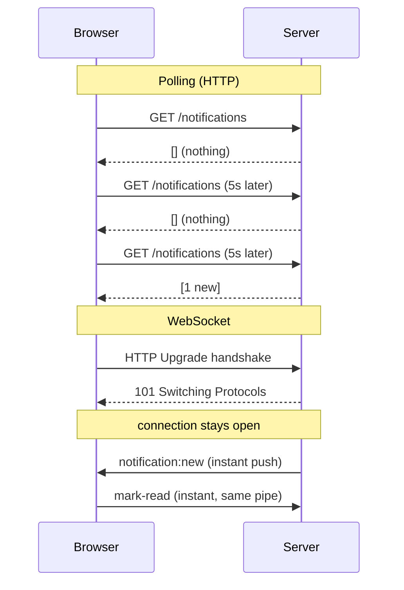

# Module 6.1 — Realtime with WebSockets & Socket.IO

> **Goal:** Understand why plain HTTP can't push data to the browser, how WebSockets fix that, what Socket.IO adds on top, and exactly what your backend's realtime layer (`backend/src/sockets/index.js`) does today — and what it is *designed* to do tomorrow.

---

## Concepts

### 1. HTTP is a one-way conversation the client starts

Everything you have built so far follows one rhythm:

1. The client (browser) sends a request.
2. The server answers.
3. The connection is done.

The server can **never** speak first. If a new notification is created for Aarav at 20:01, the server has no way to tell his browser about it. The browser has to *ask*.

### 2. Polling — the naive workaround

The oldest trick is **polling**: the frontend asks "anything new?" on a timer.

```js
// Frontend, the polling way — wasteful
setInterval(async () => {
  const res = await fetch("/api/notifications");
  render(await res.json());
}, 5000);
```

Why this hurts:

- **Waste.** If nothing changed, you still paid for a full HTTP request: TCP work, headers, cookies, auth middleware, a MongoDB query. With 10,000 students polling every 5 seconds, that's 2,000 requests *per second* that mostly return "nothing new".
- **Latency.** On average news arrives half your interval late. Poll every 5s → ~2.5s average delay. Not acceptable for a live leaderboard or a chat.
- **Rate limits.** Your own app rate-limits the API (`RATE_LIMIT_MAX` is 300 requests per 15 minutes in `backend/src/config/env.js`). A 5-second poll is 180 requests in 15 minutes — one poller alone nearly exhausts a user's budget.

**Long polling** is a refinement (the server holds the request open until something happens), but it's still request-per-message and awkward to scale.

### 3. WebSockets — a phone call instead of letters

A **WebSocket** is a persistent, two-way (full-duplex) connection between browser and server.

How it starts is clever: the client sends a *normal HTTP request* with special headers:

```
GET /socket.io/ HTTP/1.1
Connection: Upgrade
Upgrade: websocket
Sec-WebSocket-Key: dGhlIHNhbXBsZSBub25jZQ==
```

The server replies `101 Switching Protocols`, and from that moment the TCP connection stops being HTTP. It stays open, and **either side can send a message at any time**. No headers per message, no re-authentication per message, near-zero latency.



### 4. Socket.IO — WebSockets with batteries included

Raw WebSockets (the browser `WebSocket` API + Node's `ws` package) give you a pipe that carries strings. Everything else — reconnecting after Wi-Fi drops, distinguishing message types, broadcasting to groups — is your problem.

**Socket.IO** is a library on top that adds the missing production features:

| Concept | What it means |
|---|---|
| **Connection** | Each connected client is a `socket` object with a unique `socket.id`. The server-side hub is the `io` object. |
| **Events** | Messages are named. `socket.emit("chat:send", data)` on one side triggers `socket.on("chat:send", handler)` on the other. This replaces "parse the string and switch on type" with something that feels like routing. |
| **Rooms** | Named groups a socket can join: `socket.join("user:123")`. Then `io.to("user:123").emit(...)` sends to every socket in that room (a user with three tabs open = three sockets, one room). Rooms are the standard way to target *a user* or *a cohort*. |
| **Namespaces** | Separate communication channels under one connection, like sub-apps: `io.of("/admin")`. Most apps (including this one) start with just the default `/` namespace. |
| **Auth handshake** | The client can attach credentials when connecting (`io(url, { auth: { token } })`), and the server validates them in a middleware (`io.use((socket, next) => ...)`) *before* the connection is accepted — the socket equivalent of your `authenticate` middleware. |
| **Fallbacks & reconnection** | If a corporate proxy blocks WebSockets, Socket.IO silently falls back to HTTP long-polling; if the connection drops, the client auto-reconnects with backoff. You write none of that code. |
| **Acknowledgements** | An emit can carry a callback, giving request/response semantics over the socket when you need them. |

One important mental model: **Socket.IO is not a replacement for your REST API.** CRUD stays on HTTP (cacheable, testable, simple). Sockets are for the *push* direction: "something changed, here it is."

---

## In your codebase

### The honest status first

Your realtime layer is **infrastructure only**. The file's own doc comment says so — and being able to read a codebase and recognize "this is scaffolding, not features" is a real skill:

```js
// backend/src/sockets/index.js (lines 5–9)
/**
 * Socket.IO bootstrap (INFRASTRUCTURE only). Attaches a Socket.IO server to the
 * existing HTTP server and logs connections. No application events/namespaces
 * are implemented in the foundation — features add handlers here later.
 */
```

So today: clients can connect and disconnect, and that's it. No events, no rooms, no auth handshake yet. `socket.io@^4.8.1` is installed (see `backend/package.json`). Below we'll walk the real code, then look at what realtime is *for* in this app.

### Why `index.js` creates the HTTP server by hand

Look at `backend/src/index.js`:

```js
// backend/src/index.js (lines 1, 13)
import http from "node:http";
const server = http.createServer(app);
```

Until now you may have assumed servers start with `app.listen(port)`. That helper actually does exactly this — creates an `http.Server` wrapping the Express app — but it *hides* the server object. Socket.IO needs to attach to the raw HTTP server (to intercept the Upgrade handshake on `/socket.io` before Express routing sees it), so this app creates the server explicitly and passes it around:

```js
// backend/src/index.js (lines 26–27)
// 3) Realtime layer.
initSockets(server);
```

One port, one server, two protocols: normal requests go to Express, Upgrade requests on `/socket.io` go to Socket.IO.

### `backend/src/sockets/index.js`, line by line

```js
let io = null;
```

A **module-level singleton**. ES modules are evaluated once per process, so this variable is shared by everyone who imports this file. That's the whole trick behind `getIO()` — any service anywhere can grab the live server without threading it through parameters.

```js
export function initSockets(httpServer) {
  io = new SocketIOServer(httpServer, {
    cors: {
      origin: env.cors.origin,
      credentials: env.cors.credentials,
    },
    path: "/socket.io",
  });
```

- `new SocketIOServer(httpServer, ...)` — attaches to the raw server from `index.js`.
- `cors` — this is a **separate** CORS config from the Express one in `app.js`. The Socket.IO handshake is its own HTTP traffic and does not pass through your Express middleware stack; if you configured CORS only in `app.js`, browser socket connections from the frontend origin would fail. Reusing `env.cors.*` keeps both in sync from one env var.
- `path: "/socket.io"` — the URL prefix the handshake uses. This is the default, but stating it makes the contract with the frontend explicit.

```js
  io.on("connection", (socket) => {
    logger.debug(`[socket] connected: ${socket.id}`);
    socket.on("disconnect", (reason) => {
      logger.debug(`[socket] disconnected: ${socket.id} (${reason})`);
    });
  });
```

The `connection` event fires once per client. Inside, `socket` represents *that one client*. Right now the app only logs the lifecycle — note `logger.debug`, so you'll only see these lines when `LOG_LEVEL=debug` (the default in development, per `config/env.js`). The `reason` on disconnect is worth logging in real apps: `"transport close"` (network dropped) vs `"client namespace disconnect"` (clean logout) tell very different stories.

```js
export function getIO() {
  return io;
}
```

The accessor other modules will use to push events, e.g. a future `notifications.service.js` calling `getIO()?.to(`user:${userId}`).emit("notification:new", note)`. Note it returns `null` before `initSockets` runs — more on that in Pitfalls.

```js
export async function closeSockets() {
  if (io) {
    await io.close();
    io = null;
    ...
  }
}
```

Called first in the graceful-shutdown sequence (`backend/src/index.js` line 58) — you disconnect clients before tearing down the queues, Redis, and MongoDB they might trigger work against. Setting `io = null` means `getIO()` correctly reports "no realtime available" during shutdown instead of handing out a dead server.

### What will this app use realtime FOR?

Look at what already exists and it becomes obvious where sockets plug in:

- **Notifications** — there is a full `Notification` model (`backend/src/models/notification.model.js`) and REST feed (`backend/src/services/notifications.service.js` returns `{ data, unread }`). Today the bell icon can only get fresh data by refetching. The realtime upgrade: when a notification is created, emit `notification:new` to that user's room and the bell updates instantly.
- **Leaderboard** — `leaderboardEntry.model.js` + `/api/leaderboard`. Live rank changes during a mock-test evening are a natural broadcast (`io.emit("leaderboard:update", ...)` or per-scope rooms).
- **AI mentor chat** — `mentor.service.js` currently answers over plain POST. Sockets would enable streaming replies token-by-token.
- **Pomodoro/study sessions** — `pomodoroSession.model.js`; a parent or teacher dashboard could watch a student's session state live.

None of these are wired yet; that is the "features add handlers here later" from the doc comment.

### How a frontend would connect

With the current backend, this already works (it connects, gets logged, and can disconnect):

```js
// Frontend (npm install socket.io-client)
import { io } from "socket.io-client";

const socket = io("http://localhost:8080", {
  path: "/socket.io",
  withCredentials: true,          // send cookies — matches cors.credentials
});

socket.on("connect", () => console.log("connected as", socket.id));
socket.on("disconnect", (reason) => console.log("gone:", reason));

// Once the backend emits events, listening is one line each:
socket.on("notification:new", (note) => showToast(note.title));
```

And here is the shape a real **auth handshake** would take on the server — this does *not* exist yet, but it reuses `verifyAccessToken` from `backend/src/utils/jwt.util.js` exactly like the HTTP `authenticate` middleware does:

```js
// FUTURE sockets/index.js addition (not in the codebase yet)
import { verifyAccessToken } from "../utils/jwt.util.js";

io.use((socket, next) => {
  try {
    const token = socket.handshake.auth?.token;      // from io(url, { auth: { token } })
    const decoded = verifyAccessToken(token);
    socket.data.user = { id: decoded.sub, role: decoded.role };
    next();                                          // accept the connection
  } catch {
    next(new Error("unauthorized"));                 // reject the handshake
  }
});

io.on("connection", (socket) => {
  socket.join(`user:${socket.data.user.id}`);        // room per user
});
```

`io.use` is middleware for connections the way `app.use` is middleware for requests — same idea, new context.

---

## Pitfalls & gotchas

1. **`app.listen()` vs `server.listen()`.** If someone "simplifies" `index.js` to `app.listen(...)`, Express creates its *own* internal server and `initSockets(server)` attaches to one that never listens. Sockets silently never connect. The explicit `http.createServer(app)` is load-bearing.
2. **`getIO()` can return `null`.** Before `initSockets` runs (or during shutdown, or in tests that import `app.js` without booting `index.js`), there is no `io`. Any future emit site must guard: `getIO()?.emit(...)`. Tests never initialize sockets — that's intentional, and a reason emits must be optional decoration, never the source of truth.
3. **Two CORS configs.** Express CORS (`app.js`) does not cover the socket handshake. If you ever change allowed origins, change `CORS_ORIGIN` in `.env` — both layers read `env.cors.origin`, which is exactly why the code was written that way.
4. **Sockets don't scale across processes by default.** Rooms and broadcasts live in the memory of *one* Node process. Run two instances behind a load balancer and a user connected to instance A never hears events emitted on instance B. The fix is the Redis adapter (`@socket.io/redis-adapter`), which pipes emits through Redis pub/sub — and conveniently, this app already has Redis plumbing (Module 6.2).
5. **Don't send secrets in the handshake query string.** Query params end up in server logs. Use the `auth` payload (as in the example above) or cookies.
6. **Realtime is a cache, not a database.** A user who was offline missed every emit. The REST endpoint (`GET /api/notifications`) remains the source of truth on page load; sockets only deliver *deltas* while the page is open. Design every feature to work with sockets disabled.
7. **Listener leaks.** Registering `socket.on(...)` handlers inside other handlers (so they stack up per event) is the classic Socket.IO memory leak. Register once per connection, inside the `connection` callback.

---

## Exercises

Solutions to all exercises are in [SOLUTIONS.md](./SOLUTIONS.md).

1. **Warm-up (no code).** In your own words: why does `backend/src/index.js` use `http.createServer(app)` + `server.listen(...)` instead of `app.listen(...)`? What exactly would break for the realtime layer with `app.listen`?
2. **First emit.** Modify `backend/src/sockets/index.js` so the server emits a `server:time` event with the current ISO timestamp to *all* connected clients every 10 seconds. Make sure the interval is cleaned up in `closeSockets()`.
3. **Auth handshake.** Implement `io.use(...)` middleware that reads a JWT from `socket.handshake.auth.token`, verifies it with `verifyAccessToken` from `backend/src/utils/jwt.util.js`, stores `{ id, role }` on `socket.data.user`, and rejects the connection otherwise.
4. **Rooms.** Building on exercise 3: join each authenticated socket to a `user:<id>` room, and write an exported helper `emitToUser(userId, event, payload)` that safely no-ops when sockets aren't initialised.
5. **Wire a real feature.** Decide where in `backend/src/services/notifications.service.js` (or the code that *creates* notifications) an `emitToUser(userId, "notification:new", note)` call belongs, and write the patch. Explain why the emit must never replace writing the `Notification` document to MongoDB.
6. **Client side.** Write a minimal HTML page (one `<script>` using the socket.io-client CDN build is fine) that connects to `http://localhost:8080` with an auth token, logs `connect`/`disconnect`, and renders each `notification:new` payload into a list.
7. **Trace a failure.** A teammate calls `getIO().emit("leaderboard:update", data)` inside a service, and the test suite (`npm test`) crashes with `TypeError: Cannot read properties of null`. Explain precisely why this happens under tests but not under `npm start`, and fix it.

---

Next: [Module 6.2 — Background Jobs & Redis](./02-background-jobs-redis.md), where the same "optional infrastructure, ready for features" pattern shows up for queued work.
