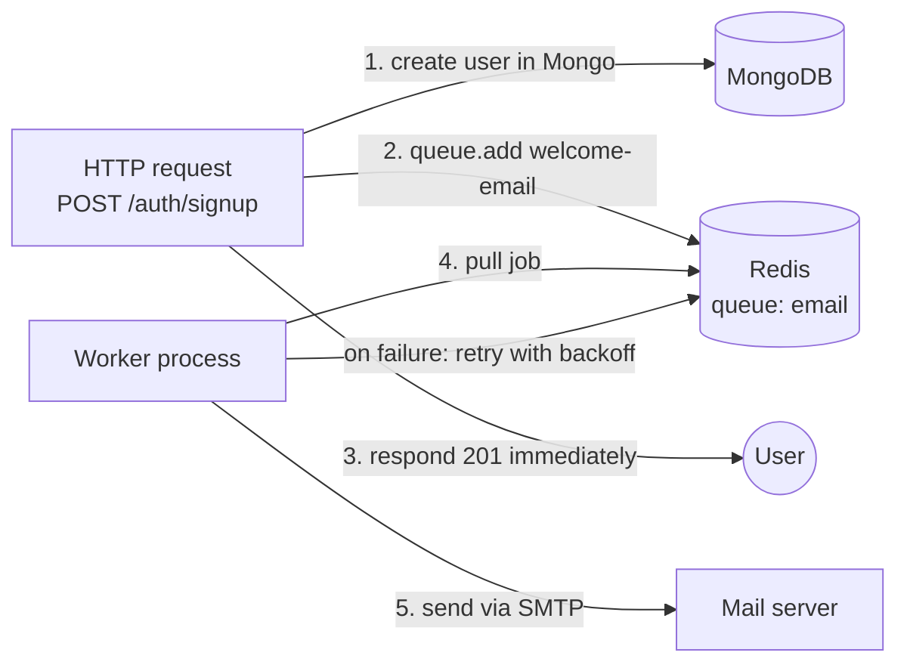

# Module 6.2 — Background Jobs, Queues & Redis

> **Goal:** Understand why some work must happen *outside* the request/response cycle, how job queues solve that, what BullMQ and Redis each contribute, and exactly what your backend's job/Redis layer does — `backend/src/jobs/` and `backend/src/config/redis.js` — including the graceful shutdown path.

---

## Concepts

### 1. The request has a budget

Every HTTP request holds resources open: a socket, an Express handler frame, the user's patience. Your handlers so far do quick things — a Mongo query, a JSON response — and finish in milliseconds. But real features need work that is:

- **Slow** — sending an email over SMTP (hundreds of ms to seconds), calling an OCR API, generating a PDF report.
- **Unreliable** — third-party APIs fail; you want retries with waits between them. You cannot keep an HTTP request open for "retry in 5 seconds, then 10".
- **Not the user's problem** — when a student signs up, they need a `201 Created` *now*; the welcome email arriving 3 seconds later changes nothing for them.

The rule of thumb: **a request should only do work whose result the response needs.** Everything else should be *deferred*.

### 2. The queue pattern

A queue decouples "deciding work must happen" from "doing the work":

- The **producer** (your request handler) drops a small description of the work — a **job**, e.g. `{ to: "aarav@example.com", template: "welcome" }` — into a queue and immediately responds to the user.
- The queue lives in a **broker** — storage *outside* your Node process, so jobs survive a crash or restart.
- A **worker** — a separate loop (same process or a different one entirely) — pulls jobs off the queue one by one and executes them. If a job fails, the worker records the failure and the queue re-delivers it later.



Why not just `sendMail(...)` without `await` and move on ("fire and forget")? Because if the process crashes, or SMTP is down for 2 minutes, the email is **gone forever** and nothing recorded that it failed. A queue gives you persistence, retries, and observability.

### 3. Redis, in one paragraph

**Redis** is an in-memory data-structure server: a key-value store on steroids (lists, sorted sets, hashes, pub/sub, atomic counters) that answers in microseconds. Because it is fast, shared between processes, and supports atomic operations, it is the standard backbone for exactly three things this app cares about:

1. **Job queues** — BullMQ stores every queue, job, and retry schedule in Redis.
2. **Shared rate limiting** — counting "requests from IP X in the last 15 min" must be shared across server instances; Redis is that shared counter (`rate-limit-redis`).
3. **Caching** — memoizing expensive reads (a leaderboard aggregation) with a TTL.

Redis holds data in RAM (with optional disk persistence) — treat it as *fast and shared*, not as your durable system of record. That's MongoDB's job.

### 4. BullMQ vocabulary

**BullMQ** (`bullmq@^5.34.0` in `backend/package.json`) is the leading Node queue library over Redis.

| Term | Meaning |
|---|---|
| **Queue** | A named channel, e.g. `new Queue("email")`. Producers call `queue.add(jobName, data, opts)`. |
| **Job** | One unit of work: a name, a JSON `data` payload, options, and a lifecycle (`waiting → active → completed | failed`, possibly `delayed` between retries). |
| **Worker** | `new Worker("email", async (job) => { ... })` — the consumer. It processes jobs, optionally many in parallel (`concurrency`). |
| **Attempts** | How many times a job may run before being declared dead (moved to the failed set). |
| **Backoff** | The wait before a retry. `exponential` with delay 5000 means retry #1 waits ~5s, retry #2 waits ~10s, doubling each time — giving a struggling downstream service room to recover instead of hammering it. |
| **removeOnComplete / removeOnFail** | Cleanup policy. Finished jobs are records in Redis; without limits they accumulate forever. |

One BullMQ hard requirement worth knowing now: its Redis connections must be created with `maxRetriesPerRequest: null`, because a worker's blocking "wait for the next job" command must be allowed to wait indefinitely rather than error out. Your codebase handles this — you'll see where.

---

## In your codebase

### The honest status first

Same pattern as the sockets layer: **the plumbing is complete, and zero queues exist yet.**

```js
// backend/src/jobs/queue.js (lines 6–10)
/**
 * BullMQ queue factory (INFRASTRUCTURE only). No concrete queues/workers are
 * defined in the foundation — features register their own via `createQueue`.
 * Every queue reuses a dedicated Redis connection (BullMQ requirement).
 */
```

Also important: **Redis itself is optional.** If no `REDIS_URL`/`REDIS_HOST` is set (the default), the app boots fine and every Redis-dependent feature quietly stays dormant. That is a deliberate architectural stance stated at the top of `backend/src/config/redis.js` (lines 5–10): *"a Redis blip never crashes the API."* MongoDB is the only hard dependency (`connectDatabase()` fails fast; everything in step 2 of `bootstrap()` in `backend/src/index.js` is best-effort).

### `backend/src/config/redis.js`, walk-through

**Detecting configuration** happens in `backend/src/config/env.js`:

```js
// backend/src/config/env.js (lines 128–136)
redis: {
  url: process.env.REDIS_URL || null,
  host: process.env.REDIS_HOST || null,
  port: num(process.env.REDIS_PORT, 6379),
  password: process.env.REDIS_PASSWORD || null,
  get isConfigured() {
    return Boolean(process.env.REDIS_URL || process.env.REDIS_HOST);
  },
},
```

`isConfigured` is a getter, evaluated on each access — set `REDIS_URL` and everything downstream flips on. Every function in `redis.js` checks it first and returns `null` when unset. This "check-and-degrade" appears in email, Cloudinary, SMS, and AI too; it is *the* signature pattern of this codebase.

**Shared options:**

```js
// backend/src/config/redis.js (lines 18–31)
export function getRedisOptions() {
  if (!env.redis.isConfigured) return null;
  if (env.redis.url) {
    return { url: env.redis.url, maxRetriesPerRequest: null, enableReadyCheck: false };
  }
  return {
    host: env.redis.host,
    port: env.redis.port,
    password: env.redis.password || undefined,
    maxRetriesPerRequest: null,
    enableReadyCheck: false,
  };
}
```

There's the BullMQ requirement, in one place so nobody can forget it: `maxRetriesPerRequest: null` (the file's own comment at line 17 flags it as REQUIRED). `enableReadyCheck: false` skips ioredis's "wait until Redis reports ready" gate — useful with managed/clustered Redis where that check can misfire.

**Two kinds of connections:**

```js
// lines 34–38 — a NEW connection each call
export function createRedisConnection() {
  const opts = getRedisOptions();
  if (!opts) return null;
  return opts.url ? new IORedis(opts.url, opts) : new IORedis(opts);
}

// lines 41–53 — ONE shared client, created lazily
export function getRedisClient() {
  if (!env.redis.isConfigured) return null;
  if (client) return client;
  client = createRedisConnection();
  client.on("connect", () => logger.info("[redis] connected"));
  ...
}
```

Why both? A BullMQ **worker parks a connection** on a blocking command while it waits for jobs — a connection doing that can't simultaneously serve your rate limiter's `INCR`. So: queues/workers get *dedicated* connections (`createRedisConnection`), while ordinary commands share *one* client (`getRedisClient`). The event listeners (`connect`, `ready`, `error`, `close`) turn socket-level noise into log lines — note `error` is a `logger.warn`, not a crash, honoring the "never fatal" contract.

**Boot and shutdown:**

```js
// lines 55–68
export async function connectRedis() {
  if (!env.redis.isConfigured) {
    logger.warn("[redis] not configured — skipping (set REDIS_URL to enable)");
    return null;
  }
  const c = getRedisClient();
  try {
    await c.ping();
    logger.info("[redis] ping OK");
  } catch (err) {
    logger.warn(`[redis] initial ping failed: ${err.message}`);
  }
  return c;
}
```

Even a failed ping is a `warn`, not a throw — ioredis will keep retrying in the background. `disconnectRedis()` (lines 70–76) tries the polite `quit()` (finish in-flight commands) and falls back to a hard `disconnect()`. `isRedisReady()` (lines 78–80) checks `client.status === "ready"` — the health endpoints use it (`backend/src/controllers/health.controller.js` reports `redis: "connected" | "unavailable" | "not-configured"`), and so does the rate limiter.

### `backend/src/jobs/queue.js`, walk-through

```js
const registry = new Map();
```

One `Map` of `name → Queue` so `createQueue("email")` called twice returns the same instance — the singleton pattern again, this time keyed.

```js
// lines 14–19
const defaultJobOptions = {
  attempts: 3,
  backoff: { type: "exponential", delay: 5000 },
  removeOnComplete: { age: 3600, count: 1000 },
  removeOnFail: { age: 24 * 3600 },
};
```

Read this as policy, not code:

- **`attempts: 3`** — run, and on failure retry up to twice more.
- **`backoff: exponential, delay 5000`** — wait ~5s before retry 1, ~10s before retry 2. Total patience: a downstream outage of up to ~15s is absorbed invisibly.
- **`removeOnComplete: { age: 3600, count: 1000 }`** — keep completed-job records at most 1 hour, at most 1000 of them (whichever trims first). Enough to debug "did it run?", not enough to bloat Redis.
- **`removeOnFail: { age: 24 * 3600 }`** — failed jobs stick around a full day, because failures are what you investigate.

```js
// lines 26–40
export function createQueue(name) {
  if (!env.redis.isConfigured) {
    logger.warn(`[jobs] Redis not configured — queue "${name}" unavailable`);
    return null;
  }
  if (registry.has(name)) return registry.get(name);

  const connection = createRedisConnection();
  const queue = new Queue(name, { connection, defaultJobOptions });
  queue.on("error", (err) => logger.warn(`[jobs] queue "${name}" error: ${err.message}`));

  registry.set(name, queue);
  logger.info(`[jobs] queue registered: ${name}`);
  return queue;
}
```

Notice the return type in the JSDoc: `Queue | null`. Callers must write `getQueue("email")?.add(...)` — if Redis is absent the feature degrades (e.g. send the email inline, or skip) rather than crashing. Also notice each queue gets its own `createRedisConnection()` — the dedicated-connection rule from above.

```js
// lines 47–52 — graceful queue shutdown
export async function closeQueues() {
  await Promise.all(
    [...registry.values()].map((q) => q.close().catch(() => undefined)),
  );
  registry.clear();
}
```

`q.close()` closes the queue's Redis connection cleanly. `.catch(() => undefined)` per queue means one stubborn queue can't make `Promise.all` reject and abort the shutdown of the others. This is re-exported through `backend/src/jobs/index.js` and called by `index.js`'s shutdown — see below.

### `backend/src/jobs/index.js`

```js
// lines 10–16
export function initJobs() {
  if (!env.redis.isConfigured) {
    logger.warn("[jobs] disabled — no Redis configured");
    return;
  }
  logger.info("[jobs] queue system ready (no queues registered yet)");
}
```

Honest to a fault: `initJobs()` currently just *reports*. When features exist, this is where their queues and Workers get registered at boot.

### Redis role #2 — the rate limiter (`backend/src/middlewares/rateLimiter.js`)

```js
// lines 13–22
function buildStore() {
  if (!env.redis.isConfigured || !isRedisReady()) return undefined;
  const client = getRedisClient();
  if (!client) return undefined;
  logger.info("[rate-limit] using Redis store");
  return new RedisStore({
    sendCommand: (...args) => client.call(...args),
    prefix: "rl:",
  });
}
```

`express-rate-limit` counts hits per IP in a **store**; the default store is a JS object in process memory. Run two API instances and each has its own counts — a client gets 2× the intended limit. `rate-limit-redis` swaps the store for Redis keys (prefixed `rl:` so you can spot them in `redis-cli KEYS 'rl:*'`), making the limit global across instances. `buildStore()` returning `undefined` means "use the memory store", which the file's comment calls "fine for a single-node foundation build".

There is a genuinely subtle timing gotcha buried here — see Pitfalls #2. Find it yourself first if you want the workout.

### Redis role #3 — caching (dormant)

`config/redis.js`'s comment lists caching as a use, and `getRedisClient()` is the tool, but **no code caches anything yet**. The pattern, when it comes, is cache-aside: try `GET`, on miss compute + `SET ... EX <ttl>`. Exercise 6 has you build it.

### Graceful shutdown, end to end (`backend/src/index.js`)

```js
// backend/src/index.js (lines 56–69, abridged)
server.close(async () => {
  await closeSockets();      // 1. disconnect realtime clients
  await closeQueues();       // 2. close BullMQ queues (their Redis connections)
  await disconnectRedis();   // 3. close the shared Redis client
  await disconnectDatabase();// 4. close MongoDB last
  process.exit(0);
});
```

The order is deliberate — shut down in *reverse dependency order*, sources of new work first:

1. `server.close()` stops accepting **new HTTP requests** (in-flight ones finish).
2. Sockets go first: connected clients are a source of new events.
3. Queues next: their dedicated connections close, and no producer can enqueue.
4. The shared Redis client, now that nothing needs it.
5. MongoDB last, because everything above might still have been writing to it.

Around it all: a 10-second `forceTimer` (lines 50–54) so a hung `close()` can't block shutdown forever — `process.exit(1)` is the escape hatch — and `.unref()` so the timer itself never keeps a finished process alive. The `shuttingDown` flag (line 45) makes a second Ctrl-C a no-op instead of a second, overlapping shutdown.

### What a real feature will look like (worked example)

This code does not exist yet — it is the intended shape, using only exports that do exist:

```js
// FUTURE: backend/src/jobs/email.jobs.js
import { Worker } from "bullmq";
import { createQueue } from "./queue.js";
import { createRedisConnection } from "../config/redis.js";
import { sendMail } from "../services/email.service.js";

export const emailQueue = createQueue("email");   // null if Redis unset

export function enqueueWelcomeEmail(user) {
  return emailQueue?.add("welcome", { to: user.email, name: user.fullName });
}

export function startEmailWorker() {
  if (!emailQueue) return null;
  return new Worker("email", async (job) => {
    await sendMail({
      to: job.data.to,
      subject: "Welcome to RankOS!",
      html: `<p>Hi ${job.data.name}, your rank journey starts now.</p>`,
    });
  }, { connection: createRedisConnection(), concurrency: 5 });
}
```

Producer side (in `auth.service.js`'s signup path): `enqueueWelcomeEmail(user)` — one line, non-blocking. `startEmailWorker()` would be called from `initJobs()`.

---

## Pitfalls & gotchas

1. **Fire-and-forget is not a queue.** `sendMail(...)` without `await` inside a handler *feels* async but loses the work on any crash and swallows failures (at best you get the process-level `unhandledRejection` log in `index.js`). If the work matters, queue it; if it doesn't matter, question why you're doing it.
2. **The import-order trap in the rate limiter.** `app.js` line 14 imports `globalRateLimiter`, which is built at module load (`rateLimiter.js` line 44 runs `createRateLimiter()` immediately). But `connectRedis()` only runs later, inside `bootstrap()` — so at the moment `buildStore()` executes, `isRedisReady()` is `false` and the limiter falls back to the **memory store, even when Redis is fully configured**. The route-level limiter in `upload.routes.js` (line 14) has the same issue. This is a real, honest limitation of the foundation build; the fix is a lazily-built store or constructing limiters after Redis connects (Exercise 5).
3. **Jobs must be idempotent.** With `attempts: 3`, your worker code can run 2–3 times for one logical job (e.g. it sent the email, then crashed before marking success). "Award 100 XP" as a job body triple-awards on retry. Design handlers so running twice equals running once (check-then-act, unique job IDs, upserts).
4. **Job data is JSON.** BullMQ serializes `job.data` through Redis. Mongoose documents, `Date` objects (become strings), functions, buffers — all get mangled or lost. Enqueue plain IDs and primitives; let the worker re-fetch fresh documents (which also avoids acting on stale data).
5. **Don't share the blocking connection.** If someone "optimizes" `createQueue`/Workers to reuse `getRedisClient()`, workers will starve normal commands (the client is parked on a blocking read). The two-function split in `redis.js` exists precisely to prevent this.
6. **Redis is not durable storage.** Default Redis persistence can lose the last seconds of writes on power loss, and ops teams routinely flush caches. Queued-but-unprocessed jobs are the acceptable casualty; user records are not. System of record = MongoDB, always.
7. **Unbounded job history.** Without `removeOnComplete`/`removeOnFail` (your defaults handle this), BullMQ keeps every finished job's data in Redis forever. Real teams have filled entire Redis instances with completed-job corpses.
8. **Workers need a shutdown path too.** When Workers exist, graceful shutdown must also `await worker.close()` (waits for the in-flight job to finish) *before* closing Redis — otherwise you kill a job mid-flight and rely on retries you were trying to avoid.

---

## Exercises

Solutions to all exercises are in [SOLUTIONS.md](./SOLUTIONS.md).

1. **Retry math.** A job on a queue created by `createQueue` fails every time it runs. Using `defaultJobOptions` from `backend/src/jobs/queue.js`, write the full timeline: how many executions, with what waits between them, and where does the job's record end up — and for how long?
2. **Why `maxRetriesPerRequest: null`?** In your own words (2–4 sentences), explain what this ioredis option does and why BullMQ refuses to work without it. Hint: what is a worker's connection doing while the queue is empty?
3. **Build the email queue.** Write `backend/src/jobs/email.jobs.js` as sketched in the chapter: a `createQueue("email")` queue, an `enqueueWelcomeEmail(user)` producer that safely no-ops without Redis, and a `startEmailWorker()` that sends via `sendMail` from `backend/src/services/email.service.js`. Wire `startEmailWorker()` into `initJobs()`.
4. **Shutdown for workers.** Extend your exercise-3 code and `backend/src/index.js`'s shutdown sequence so the worker closes gracefully. Where exactly in the `server.close` callback does `worker.close()` belong, and why there?
5. **Find and fix the import-order trap.** Prove to yourself (by tracing imports from `backend/src/index.js` line 3 onward) that `globalRateLimiter` can never get the Redis store today. Then fix `buildStore` so the Redis store is picked up lazily once Redis is ready, without changing `app.js`.
6. **Cache-aside helper.** Add `cacheGetJSON(key)` and `cacheSetJSON(key, value, ttlSeconds)` helpers to a new `backend/src/utils/cache.util.js` using `getRedisClient()` — both must silently no-op (return `null` / do nothing) when Redis is unavailable. Show how you'd wrap a hypothetical expensive `leaderboard.service.js` read with a 60-second TTL.
7. **Idempotency audit.** The job `{ name: "award-xp", data: { userId, amount: 100 } }` increments a user's XP in its worker. Explain the double-award failure scenario under `attempts: 3`, then redesign the job (data shape and/or worker logic) to be idempotent.
8. **Ordering quiz.** In `backend/src/index.js`, could `disconnectRedis()` safely run *before* `closeQueues()`? What would actually happen to the queues' connections and why does the current order avoid that ambiguity?

---

Next: [Module 6.3 — Email, Uploads & External Services](./03-email-uploads-external-services.md) — the third-party integrations that background jobs typically carry.
