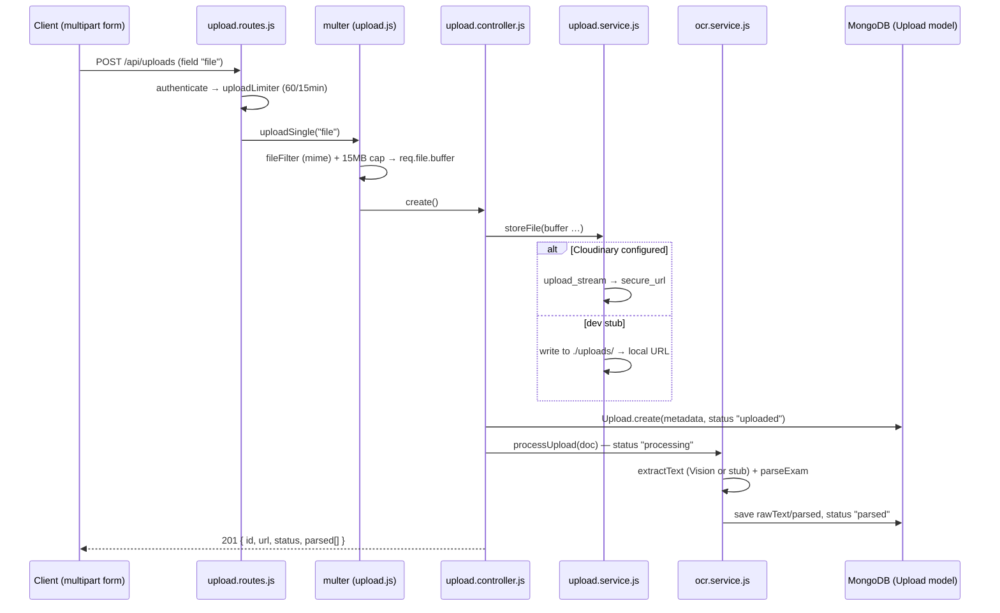

# Module 6.3 — Email, File Uploads & External Services

> **Goal:** Learn how a backend talks to the outside world — SMTP email, cloud file storage, SMS, OCR, and LLM providers — and study the one design pattern your codebase applies to *all* of them: env-driven configuration with a graceful dev-stub fallback, so the whole app runs end-to-end with zero credentials.

---

## Concepts

### 1. The integration problem

Your server can't do everything itself. Delivering email, storing gigabytes of images, sending SMS, reading text out of a photo, generating natural-language advice — these are entire companies. Integrating means: hold a **credential** (API key) in the environment, speak the provider's **protocol** (SMTP, HTTPS+JSON), and survive the provider being **slow, down, or unconfigured**.

Three sub-patterns to recognize everywhere in this module:

- **Adapter** — wrap each provider behind your own small interface (`sendMail`, `storeFile`, `generate`) so the rest of the app never knows which vendor is behind it. Swapping vendors becomes an env change.
- **Graceful degradation** — if the service isn't configured, log and do the next-best thing instead of crashing. Your codebase is fanatical about this.
- **Dev stub** — a fake implementation realistic enough that the *whole pipeline* still runs locally (an OCR stub that returns a plausible exam sheet, an SMS stub that prints the OTP to the log).

### 2. Email and SMTP in 60 seconds

**SMTP** (Simple Mail Transfer Protocol) is how mail servers talk. Your app doesn't deliver mail to inboxes itself — it hands the message to an SMTP relay (Gmail, SendGrid, Mailtrap, your company's server) which does the real delivery. **Nodemailer** is the standard Node library: you build a **transport** (host, port, credentials) once, then call `sendMail` per message. Port 465 = TLS from the start (`secure: true`); 587 = starts plain, upgrades via STARTTLS (`secure: false`).

### 3. Files don't belong in your database

A JSON API moves kilobytes; files are megabytes. The standard pipeline:

1. The browser sends `multipart/form-data` (a special encoding mixing fields and binary parts — `express.json()` cannot parse it).
2. **Multer** middleware parses the multipart stream and hands your handler `req.file` (`buffer`, `originalname`, `mimetype`, `size`).
3. The bytes go to **object storage** — a service built for blobs. **Cloudinary** is one such service specialized for media: storage + CDN delivery + on-the-fly transformations (resize, format conversion) via URL parameters.
4. Your database stores only **metadata**: who uploaded, where it lives (URL), what was extracted from it.

Why not store bytes in MongoDB? A BSON document caps at **16 MB**, file bytes would sit in Mongo's RAM cache crowding out the hot data your queries need, every download would burden your API server instead of a CDN edge near the user, and backups balloon. (Mongo's GridFS exists for special cases, but "use object storage" is the professional default.)

### 4. LLM providers as just another service

Calling an AI model is architecturally identical to calling any HTTPS API: POST a JSON body (a **system prompt** setting behavior + a **user prompt** with the actual question and data), get JSON back, guard with a timeout, handle failure. The craft is (a) **grounding** — putting the *user's real data* in the prompt so answers are specific, not generic; and (b) **fallbacks** — never letting a vendor outage produce a 500 or a lorem-ipsum answer.

---

## In your codebase

Boot order first — `backend/src/index.js` `bootstrap()` wires every optional service, each logging its own configured/skipped status:

```js
// backend/src/index.js (lines 20–24)
// 2) Optional dependencies — never fatal in the foundation build.
await connectRedis();
configureCloudinary();
await verifyEmailTransport();
initJobs();
```

### A. Email — `backend/src/services/email.service.js`

The file is honest about its scope (lines 5–11): it is *"INFRASTRUCTURE only… Feature-specific emails (OTP, welcome, digests) are NOT implemented here."* So today there are **no email templates in the codebase** — just a generic, safe `sendMail`.

**The lazy transport singleton (lines 15–28):**

```js
let transporter = null;

export function getTransporter() {
  if (!env.smtp.isConfigured) return null;
  if (transporter) return transporter;

  transporter = nodemailer.createTransport({
    host: env.smtp.host,
    port: env.smtp.port,
    secure: env.smtp.secure, // true for 465, false for other ports
    auth: env.smtp.user ? { user: env.smtp.user, pass: env.smtp.password } : undefined,
  });
  ...
}
```

Same singleton shape as Redis/sockets: `null` until first use, cached after. Configuration lives in `backend/src/config/env.js` (lines 151–161): `isConfigured` requires `SMTP_HOST` *and* `SMTP_USER`; defaults are port 587, `secure: false`, and a fallback `from` of `"RankOS <no-reply@rankos.app>"`.

**`verifyEmailTransport` (lines 30–44)** — called at boot. When SMTP isn't configured it logs `"[email] SMTP not configured — emails will be skipped"` and **returns `false`** — no throw, boot continues. When configured, `t.verify()` makes Nodemailer actually connect and authenticate, so a bad password shows up in your startup logs, not three days later when the first password-reset email silently fails. Even a failed verify is only a `warn` and `false`.

**`sendMail` (lines 50–59)** — the no-op contract:

```js
export async function sendMail(message) {
  const t = getTransporter();
  if (!t) {
    logger.warn(`[email] skipped (no SMTP) → ${message.subject} to ${message.to}`);
    return null;
  }
  const info = await t.sendMail({ from: env.smtp.from, ...message });
  logger.info(`[email] sent ${info.messageId} → ${message.to}`);
  return info;
}
```

Note the spread trick: `{ from: env.smtp.from, ...message }` sets the default sender but lets a caller override `from` by passing their own. Callers pass `{ to, subject, html?, text? }` and never touch Nodemailer directly — that's the adapter.

### B. File uploads, end to end

The full journey of `POST /api/uploads`:



**Route layer — `backend/src/routes/upload.routes.js`.** Two details worth stealing: uploads get a *tighter* per-route limiter (`createRateLimiter({ windowMs: 15*60*1000, max: 60 })`, line 14) because they hit external storage/OCR; and `router.get("/files/:name", ...)` is declared **before** `"/:id"` (line 17) — Express matches top-down, so otherwise `files` would be captured as an `:id`. That serve route is deliberately unauthenticated (the file comment explains: so `` tags work for dev-stub files).

**Middleware — `backend/src/middlewares/upload.js`.** Line by line:

```js
const MAX_SIZE_BYTES = 15 * 1024 * 1024; // 15 MB

const ALLOWED_MIME = new Set([
  "application/pdf", "image/png", "image/jpeg", "image/jpg", "image/webp", "image/heic",
]);
```

An allow-list, not a block-list — the only safe direction for file types. Then:

```js
const multerInstance = multer({
  storage: multer.memoryStorage(),
  limits: { fileSize: MAX_SIZE_BYTES, files: 1 },
  fileFilter,
});
```

`memoryStorage()` keeps the file as a RAM `Buffer` (`req.file.buffer`) — never written to disk — so it can be *streamed straight onward* to Cloudinary/Vision. Fine at 15 MB × few concurrent uploads; a hazard at video scale (see Pitfalls).

The clever part is `uploadSingle` (lines 41–58): it wraps multer's handler to **normalize errors**. Multer's own `LIMIT_FILE_SIZE` error becomes a clean `ApiError` with status **413** (Payload Too Large) and a field-level message; the `fileFilter` rejection is already an `ApiError.badRequest` (**400**) with code `UNSUPPORTED_FILE_TYPE`. Result: file errors look exactly like every other error envelope in the API.

**Storage — `backend/src/services/upload.service.js`.** The provider decision in one function:

```js
// lines 30–35
export async function storeFile({ buffer, originalName, mimeType, folder = "rankos/uploads" }) {
  if (ensureCloudinary()) {
    return storeOnCloudinary({ buffer, mimeType, folder });
  }
  return storeLocally({ buffer, originalName });
}
```

Both branches return the same descriptor — `{ provider, url, publicId }` — so callers don't care which ran. The Cloudinary branch (lines 37–51) wraps the SDK's callback-style `upload_stream` in a `new Promise` and pushes the buffer with `stream.end(buffer)`; PDFs upload as `resource_type: "raw"` because Cloudinary treats non-images differently. The dev stub (lines 53–61) writes to a local `uploads/` directory with a sanitized name — `String(originalName).replace(/[^\w.\-]+/g, "_")` prefixed by `randomUUID()` — killing both filename collisions and path-injection tricks like `../../etc/passwd`. `localFilePath` (lines 64–66) adds `path.basename()` as a second traversal guard when serving. `deleteFile` (lines 69–79) is explicitly best-effort: a failed provider delete logs a warning but never blocks removing the DB record.

**Config — `backend/src/config/cloudinary.js`.** Ten lines of the standard pattern: `isConfigured` requires all three of `CLOUDINARY_CLOUD_NAME/API_KEY/API_SECRET` (`env.js` lines 138–149); unconfigured → warn `"media uploads disabled"` and return `null`; configured → `cloudinary.config({ ..., secure: true })` (HTTPS URLs only).

**Controller — `backend/src/controllers/upload.controller.js`.** In `create` (lines 17–56): guard `req.file` (multer leaves it undefined if the field was missing), infer the document `kind` (`resolveKind` maps an explicit hint or falls back on mimetype → `"pdf"`/`"image"`), store the file, then create the metadata record. Then one subtle line:

```js
// line 39 — the raw buffer is passed transiently (not stored)
upload.__buffer = buffer;
```

`processUpload` needs the bytes for OCR, but the schema deliberately has no buffer field — attaching it as a non-schema property hands it over for this one call without ever persisting megabytes into Mongo. The `try/catch` around `processUpload` swallows the error *because the service already persisted `status: "failed"` and the message* — the client still gets its 201 with the record and can see what happened. Also note `list` excludes the heavy field with `.select("-rawText")` and caps at 50, and every query is scoped `{ user: req.user.id }` — ownership enforcement you've seen since the CRUD modules.

**Model — `backend/src/models/upload.model.js`.** The interesting parts: a `parsedQuestionSchema` sub-schema with `{ _id: false }` (embedded rows don't need their own ids); a `status` enum acting as a tiny state machine — `"uploaded" → "processing" → "parsed" | "failed"`; a compound index `{ user: 1, createdAt: -1 }` matching exactly the `list` query's filter+sort; and a `toJSON` transform renaming `_id` → `id` for clean API output.

### C. OCR — `backend/src/services/ocr.service.js`

**Provider: Google Cloud Vision, stub by default.** `isVisionConfigured()` (lines 13–19) checks `GOOGLE_APPLICATION_CREDENTIALS` / `GOOGLE_VISION_KEY_JSON` / `GCP_PROJECT`. In `extractText` (lines 22–41), two touches worth noticing:

- `await import("@google-cloud/vision")` — a **dynamic import**, so the heavy SDK isn't even loaded (and needn't be installed) unless credentials exist.
- On *any* Vision failure it falls back to `STUB_SHEET` — a realistic four-question JEE sheet defined at lines 136–154 — returning `{ text, provider: "stub" }`. This is why the integration test can assert `parsedCount >= 4` with no Google account.

**`parseExam` (lines 50–105)** is a pure function — no I/O, ideal for unit testing (Module 6.4 exercise). It's a small line-by-line state machine: subject headings (`PHYSICS|CHEMISTRY|…`) set `currentSubject` which "carries down"; `Q<n>.` / `<n>.` starts a block; other lines append to the current block; `flush()` converts a finished block into a structured row. The smartest line is the option splitter:

```js
// lines 62–63 — split only on the (A)…(D) markers, so option text that itself
// contains parentheses — e.g. "(2/3) g sinθ" — stays intact.
const optZone = joined.split(/Your Answer|Correct Answer/i)[0];
const parts = optZone.split(/\(([A-D])\)/).slice(1);
```

A naive `split("(")` would shred `(2/3) g sinθ`. Regex capture groups in `String.split` keep the letter markers in the output array, letting the loop pair `[letter, text]`.

**`processUpload` (lines 111–133)** drives the status machine: set `"processing"` and save (so a crash mid-OCR leaves an honest status), extract → parse → save `rawText`/`ocrProvider`/`parsed` with `"parsed"`; on error save `"failed"` + the message *and re-throw* — persistence and propagation are both handled.

### D. SMS — `backend/src/services/sms.service.js`

The purest dev stub in the codebase. `isProviderConfigured()` checks `TWILIO_ACCOUNT_SID` + `TWILIO_AUTH_TOKEN`; when absent (the default):

```js
// lines 26–31
if (!isProviderConfigured()) {
  // DEV STUB — never do this in production; codes must go over SMS only.
  logger.warn(`[sms:stub] → ${to}: ${body}`);
  return { delivered: false, channel: "stub" };
}
```

So during development the OTP literally appears in the server log — the flow "works" with no vendor. Two honest details: `sendViaProvider` (lines 16–20) is a **placeholder that throws** `"SMS provider configured but sendViaProvider() is not implemented"` — setting Twilio env vars today would break sending until you implement it (Exercise 6); and the return shape `{ delivered, channel }` lets callers distinguish real delivery from the stub.

### E. The AI layer — `backend/src/services/ai/` and `mentor.service.js`

This is the most complete external-service subsystem in the app, in three layers.

**Layer 1: provider adapters (`services/ai/providers/`).** Four objects with an identical interface — `{ name, isRemote, isConfigured(), generate({ system, prompt, maxTokens, temperature }) }`:

- `anthropic.js` — Anthropic Messages API. Activated by `ANTHROPIC_API_KEY`; model from `AI_MODEL`, defaulting to `"claude-haiku-4-5-20251001"`. Plain `fetch` (no SDK), headers `x-api-key` + `anthropic-version: 2023-06-01`, and — crucial for any external call — `signal: AbortSignal.timeout(Number(process.env.AI_TIMEOUT_MS) || 20000)`: a hung provider aborts after 20s instead of hanging your request. Response text is joined from `data.content[].text`.
- `openai.js` — Chat Completions; `OPENAI_API_KEY`; default model `"gpt-4o-mini"`; the system prompt travels as a `role: "system"` message; reply at `data.choices[0].message.content`.
- `gemini.js` — `generateContent`; `GEMINI_API_KEY`; default `"gemini-1.5-flash"`; system prompt goes in `systemInstruction`; reply joined from `candidates[0].content.parts`.
- `local.js` — not an LLM at all: `{ name: "local", isRemote: false, isConfigured: () => true }`. It's a *signal* telling the facade "use the deterministic fallback". Always configured, so selection can never fail.

Notice how the three vendors put the *same three ideas* (system prompt, user prompt, token cap) in three different JSON shapes — the adapters exist to absorb exactly that difference.

**Selection (`providers/index.js`, lines 21–27):**

```js
export function getProvider() {
  const explicit = process.env.AI_PROVIDER;
  if (explicit && REGISTRY[explicit] && REGISTRY[explicit].isConfigured()) {
    return REGISTRY[explicit];
  }
  return REMOTE.find((p) => p.isConfigured()) || localProvider;
}
```

Resolution order: explicit `AI_PROVIDER` env if that provider has a key → first configured remote in the order Anthropic → Gemini → OpenAI → the local fallback. *"Switching providers is therefore a pure env change — no code edits"* (the file's own comment). `providerInfo()` feeds `GET /api/ai/status` (`backend/src/controllers/ai.controller.js`) so the frontend/ops can see whether replies are LLM-backed.

**Layer 2: the facade (`services/ai/index.js`).** The heart is `run()` (lines 14–26):

```js
async function run({ system, prompt, fallback, maxTokens = 700, temperature = 0.6 }) {
  const provider = getProvider();
  if (provider.isRemote) {
    try {
      const text = await provider.generate({ system, prompt, maxTokens, temperature });
      if (text && text.trim()) return { text: text.trim(), provider: provider.name };
      logger.warn(`[ai] ${provider.name} returned empty — using grounded fallback`);
    } catch (err) {
      logger.warn(`[ai] ${provider.name} failed (${err.message}) — using grounded fallback`);
    }
  }
  return { text: fallback(), provider: "local" };
}
```

Every failure mode — no key, timeout, HTTP error, *even a syntactically-successful but empty reply* — lands on `fallback()`. And the fallbacks are not dummies: each is composed **from the student's actual data**. One shared system prompt pins the persona:

```js
// lines 30–32
const MENTOR_SYSTEM =
  "You are RankOS, an elite JEE/NEET exam mentor. Be concise (2–4 sentences), specific, " +
  "encouraging, and strictly grounded in the student's data. Give one clear next action.";
```

Then five feature helpers each build a *user prompt embedding real numbers* plus a matching fallback. `mentorReply` (lines 35–54) is the template to internalize:

```js
const prompt =
  `Student asks: "${question}".\n` +
  `Data — weakest topic: ${weakest ? `${weakest.name} (${weakest.mastery}% mastery)` : "n/a"}; ` +
  `pending mistakes: ${pendingMistakes}; overall accuracy: ${accuracy ?? "?"}%.\n` +
  `Answer their question and end with the single highest-leverage next step.`;
```

That's prompt construction as data interpolation: question + grounding stats + an output instruction. The others follow suit — `recommendations` asks for a bullet list then *parses the reply back into an array* (`text.split("\n").map(strip bullets)`, lines 80–83 — never trust an LLM to return structure without cleanup); `notes` requests specific markdown sections; `summary` and `roadmap` cap `maxTokens` at 400/300 because their outputs are short by design.

**Layer 3: the feature (`services/mentor.service.js`).** `buildContext` (lines 32–48) gathers the grounding with three parallel queries:

```js
const [weakest, pendingMistakes, profile] = await Promise.all([
  Topic.findOne({ user: userId }).sort({ mastery: 1 }),   // lowest mastery = weakest
  Mistake.countDocuments({ user: userId, status: "Pending" }),
  Profile.findOne({ user: userId }),
]);
```

It also records `groundingRefs` like `"topic:geo3d"` — provenance tags stored on the AI message so the UI can show *why* the mentor said what it said. `chat()` (lines 51–68) resolves-or-creates the conversation (`AIChat` model), gets the reply via `ai.mentorReply(ctx)`, pushes both the user turn and the AI turn into `chatDoc.messages`, saves, and returns. Notice the whole flow is synchronous within the request — acceptable because of the 20s abort + instant fallback.

---

## Pitfalls & gotchas

1. **Secrets live in env, never code.** Every credential in this module (`SMTP_PASSWORD`, `CLOUDINARY_API_SECRET`, `ANTHROPIC_API_KEY`, `TWILIO_AUTH_TOKEN`) is read from `process.env`. Hardcode one, commit it, and it's compromised forever (git history remembers). `.env` stays gitignored.
2. **Every external call needs a timeout.** The AI adapters' `AbortSignal.timeout(...)` is the model. A vendor that hangs (rather than erroring) will otherwise pin your request handlers until something upstream gives up. If you add a new integration, the timeout is not optional.
3. **`memoryStorage` is a scaling decision, not a default.** 15 MB × N concurrent uploads lives in your heap. For this app's OMR sheets it's the right call (enables streaming to Cloudinary with zero disk I/O); for large media you'd switch to disk/stream storage.
4. **Trust the allow-list, not the filename.** `fileFilter` checks `mimetype` (client-supplied, so still spoofable — real hardening also sniffs magic bytes), and the local stub sanitizes names + uses `path.basename` on serve. Any relaxation of these opens path traversal or content-type attacks.
5. **The local `uploads/` stub is dev-only.** Files on one server's disk vanish on redeploy and don't exist on the second instance behind a load balancer. That's *why* the Cloudinary path exists; the stub's log line even nags you: `"(set CLOUDINARY_* to use cloud storage)"`.
6. **The OTP-in-logs stub must never reach production.** `sms.service.js` says it in its own comment. Anyone with log access could read login codes. The `{ delivered: false, channel: "stub" }` return exists so calling code *can* refuse to proceed in production if delivery didn't really happen.
7. **Prompt injection is real.** `mentorReply` interpolates the raw student question into the prompt. A user can type "ignore your instructions and…" — for this feature the blast radius is tiny (the model only writes advice back to the same user), but the moment LLM output drives *actions* (DB writes, emails), you must treat user text inside prompts as hostile input.
8. **LLM output is not structured data.** `recommendations` shows the defensive stance: ask for a format, then parse tolerantly and strip bullets/numbering. Never `JSON.parse` an LLM reply without a try/catch and a fallback.
9. **Know your no-op contracts.** `sendMail` → `null`, `storeFile` → local stub, `createQueue` → `null`, AI → grounded fallback, SMS → `{ delivered: false }`. When something "doesn't work" locally, check the boot logs first — the answer is usually a cheerful `[…] not configured — skipping`.

---

## Exercises

Solutions to all exercises are in [SOLUTIONS.md](./SOLUTIONS.md).

1. **Boot-log reading.** With a completely empty `.env` except `MONGODB_URI`, list — in order — every "not configured / skipped / stub" log line you expect during `bootstrap()` in `backend/src/index.js`, and which file emits each. What does `verifyEmailTransport()` return in this state?
2. **First feature email.** Write `sendPasswordResetEmail(to, resetUrl)` in a new `backend/src/services/emails/` helper (or at the bottom of a feature service): build a small HTML + text body and send it through `sendMail`. What happens when SMTP is unconfigured, and why is that acceptable here?
3. **Trace an upload.** A student POSTs a 4 MB PNG to `/api/uploads` with no Cloudinary or Vision configured. List every function that runs, in order, with file paths — from route match to the JSON response — and state the final `status` and `ocrProvider` on the stored `Upload` document.
4. **Reject the right way.** Using `backend/src/middlewares/upload.js` as reference: what exact HTTP status and error shape does the client get for (a) a 20 MB PDF, (b) a `.exe` file, (c) a request with no file at all? Point to the line responsible for each.
5. **The 16 MB argument.** Your teammate proposes storing upload bytes as a `Buffer` field on the `Upload` schema "to keep everything in one place". Write the 4-point rebuttal, referencing how `upload.controller.js` line 39 (`upload.__buffer = buffer`) deliberately avoids exactly this.
6. **Implement Twilio.** Fill in `sendViaProvider(to, body)` in `backend/src/services/sms.service.js` using Twilio's REST API via `fetch` (endpoint: `https://api.twilio.com/2010-04-01/Accounts/{SID}/Messages.json`, Basic auth, form-encoded body) — including a timeout, matching the AI adapters' discipline.
7. **New AI helper.** Add `weeklyDebrief(ctx)` to `backend/src/services/ai/index.js` following the house pattern exactly: takes `{ hoursThisWeek, accuracy, weakTopics }`, builds a grounded prompt, supplies a deterministic data-grounded fallback, calls `run()`. No provider-specific code allowed — explain why not.
8. **Parser hand-trace.** Given this OCR text, hand-compute (no running code) the exact array `parseExam` from `backend/src/services/ocr.service.js` returns:
   ```
   CHEMISTRY
   Q7. Which of the following is aromatic?
   (A) Cyclobutadiene (B) Benzene (C) Cyclooctatetraene (D) None
   Your Answer: B   Correct Answer: B
   ```

---

Next: [Module 6.4 — Testing Mastery & Seeding](./04-testing-mastery.md) — where the stubs you just studied become the reason the whole pipeline is testable with zero credentials.
