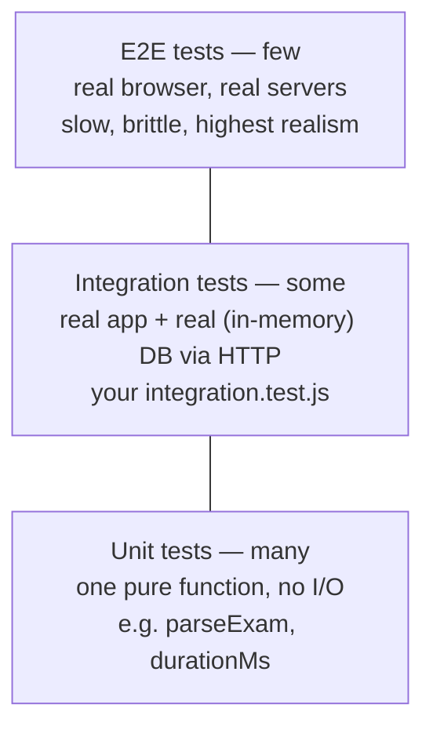

# Module 6.4 — Testing Mastery & Seeding

> **Goal:** Understand why automated tests exist, learn the modern zero-dependency Node testing stack (`node --test` + supertest + mongodb-memory-server), walk through your real test files line by line, write a brand-new test for the tasks feature, and master the seed system that gives both tests and dev environments realistic data.

---

## Concepts

### 1. Why tests exist

A test is a program that runs your program and checks the result. The payoff is not "proving it works today" — you already clicked around and know that. The payoff is **regression safety**: six weeks from now, when you refactor `auth.service.js`, a green test suite is what tells you in 10 seconds that login, cookies, ownership checks, and the upload pipeline all still behave. Without tests, every change means re-clicking through the whole app — so changes stop happening, and the codebase fossilizes. Tests are also **executable documentation**: `integration.test.js` is the most precise description of your API's contract that exists.

### 2. The testing pyramid



- **Unit tests** exercise one function in isolation — fast (microseconds), pinpoint failures. `parseExam` in `ocr.service.js` is a perfect unit-test target: pure input → output, no database.
- **Integration tests** exercise real layers wired together — routes, middleware, services, Mongo — and answer "does the *system* work?". Your suite is mostly this, which is the right call for a CRUD-heavy API: one integration test covers dozens of units.
- **E2E tests** drive a real browser against a deployed stack. None here yet; they earn their cost later.

### 3. The tools — all lightweight, mostly built-in

**`node --test`** — since Node 18/20, the test runner ships *inside Node*. No Jest, no config file, no transpiler. You import `test` from `node:test` and assertions from `node:assert/strict`, and run `node --test <glob>`. Key behaviors: each **test file runs in its own child process** (isolation for free — env vars and module caches don't leak between files), and `before`/`after` hooks handle setup/teardown per file.

**supertest** (dev dependency) — HTTP assertions against an Express `app` object *without listening on a port*. `request(app).get("/api/health")` boots the app's request pipeline in-process, feeding it a fake socket. This is exactly why your app is split into two files:

- `backend/src/app.js` — *builds* the Express app and exports it. Its own comment (line 22): *"Exported WITHOUT starting a server so it can be imported by tests."*
- `backend/src/index.js` — *runs* it: creates the HTTP server, connects Mongo/Redis, listens, handles shutdown.

Tests import `app.js` and get the entire middleware stack, routes, and error handling — but no port binding, no socket server, no Redis, no lifecycle. That separation is the single most important testability decision in the codebase.

**mongodb-memory-server** (dev dependency) — downloads a real `mongod` binary (first run only) and starts it against an in-memory filesystem. Your tests run queries against a **real MongoDB** — real indexes, real validation, real query semantics — that appears in milliseconds, needs no install or Docker, and vanishes without a trace. No mocking of Mongoose, and zero risk of a test wiping a real database.

### 4. Seeding

**Seeding** is scripted insertion of known data into a database. Two audiences: *developers* (a fresh clone runs `npm run seed` and every page instantly shows realistic data instead of empty states) and *tests* (assertions need known values — "streak is 46" only works if the seed put 46 there). Good seeds are **idempotent**: safe to run repeatedly because they clear-then-insert.

---

## In your codebase

### Running the suite

`backend/package.json` (line 14):

```json
"test": "node --test \"src/tests/**/*.test.js\""
```

So, from `backend/`:

```bash
npm test                                        # everything
node --test src/tests/health.test.js            # one file
node --test --test-name-pattern="upload" src/tests/  # tests whose names match
```

First run of the integration suite is slow while mongodb-memory-server downloads its `mongod` binary; afterwards it's cached. There are two test files, one per pyramid layer boundary: a fast smoke test and a full end-to-end suite.

### `backend/src/tests/health.test.js` — line by line

```js
import test from "node:test";
import assert from "node:assert/strict";
import request from "supertest";
```

`assert/strict` makes `assert.equal` use `===` semantics — always use the strict flavor.

```js
// Ensure required env exists before importing the app (env.js validates on load).
process.env.NODE_ENV = process.env.NODE_ENV || "test";
process.env.MONGODB_URI = process.env.MONGODB_URI || "mongodb://localhost:27017/rankos_test";

const { app } = await import("../app.js");
```

The single most instructive detail in the file. `backend/src/config/env.js` runs `ensureRequired()` **at import time** and calls `process.exit(1)` if `MONGODB_URI` is missing. A static `import { app } from "../app.js"` at the top would be hoisted and evaluated *before* the `process.env` assignments — the test process would die instantly on a machine without a `.env`. The fix: set env first, then use a **dynamic `await import()`** (top-level await, allowed in ES modules). Note also: nothing here ever *connects* to that Mongo URI — importing `app.js` builds middleware and routes but `connectDatabase()` lives only in `index.js`. These four tests touch no database at all.

The four tests:

1. `GET /api/health/live → 200 alive` — asserts the response envelope (`success: true`, `data.status === "ok"`). Exercises the whole middleware stack: helmet, CORS, rate limiter, router, `ApiResponse`.
2. `GET /api/health → 200 with dependency info` — asserts `data.dependencies` exists and `uptimeSeconds` is a number. If you check `health.controller.js`, `dependencies.mongodb` here reports `"disconnected"` — the test (correctly) asserts shape, not connectivity.
3. `unknown route → 404 with error envelope` — proves the `notFound` middleware and error envelope (`success: false`, `error.code === "NOT_FOUND"`) work. Cheap test, huge value: it locks your error *contract*.
4. `every response carries an x-request-id header` — locks in the `requestId` correlation middleware.

### `backend/src/tests/integration.test.js` — line by line

The header comment (lines 1–9) tells you the whole strategy, including *why* it's safe:

> `node --test` runs each test file in its own process, so setting `MONGODB_URI` in `before()` (prior to the first config import) safely points the app at the in-memory database.

**Setup (`before`, lines 19–37):**

```js
before(async () => {
  mongod = await MongoMemoryServer.create();
  process.env.MONGODB_URI = mongod.getUri();
  process.env.NODE_ENV = "test";
  process.env.SWAGGER_ENABLED = "false";

  const seeds = await import("../seeds/index.js");
  await seeds.run();

  const { app } = await import("../app.js");
  mongoose = (await import("mongoose")).default;
  const supertest = (await import("supertest")).default;
  api = supertest(app);

  const login = await api
    .post("/api/auth/login")
    .send({ identifier: "aarav@example.com", password: "password123", rememberMe: true });
  cookies = login.headers["set-cookie"];
});
```

Step by step:

1. **Spin up in-memory Mongo** and point `MONGODB_URI` at it — *before any app module loads*, so when `env.js` freezes its config, it captures the in-memory URI. Every import in this file is dynamic for exactly this reason.
2. **Seed** — importing `../seeds/index.js` does *not* auto-run it (the `invokedDirectly` guard, see below); calling `seeds.run()` connects Mongoose and inserts the full demo dataset. Now the DB contains Aarav, his 46-day streak, five tasks for today, mistakes, tests, everything in `seeds/data.js`.
3. **Build the API handle** — `supertest(app)`, no port.
4. **Log in once** as the seeded student (`aarav@example.com` / `password123` from `seeds/data.js` lines 6–9) and capture the `Set-Cookie` headers. The one-liner at line 44 replays them on any request:

```js
const auth = (req) => req.set("Cookie", cookies);
```

**Teardown (`after`, lines 39–42):** disconnect Mongoose, stop the memory server. Skip either and the process would hang on open handles (the runner would eventually complain).

**The tests, and what each one really proves:**

| Test (line) | What it locks down |
|---|---|
| `login issues a session cookie` (46) | The auth flow sets an `access_token` cookie — the foundation everything below rests on. |
| `signup validation returns 422 with field errors` (50) | The zod validator layer rejects bad input with *field-level* errors, not a generic 500. |
| `GET /auth/me requires authentication` (58) | Unauthenticated → 401. One line, guards the entire `authenticate` middleware. |
| `dashboard returns seeded student data` (62) | Asserts `streak === 46` and `todayPlan.length === 5` — values traceable directly to `seeds/data.js` (`demoStudent.streak`, the 5-item `todayPlan`). Seeds and tests are one system. |
| `mistakes filter works and rejects NoSQL injection` (69) | `?status=Pending` filters correctly; `?status[$ne]=Pending` — a classic operator-injection payload — is stripped by the `sanitize` middleware and treated as no filter. A security regression test. |
| `AI status reports the grounded local provider` (79) | With no API keys in the test env, `/api/ai/status` must say `provider: "local"` — the fallback chain from Module 6.3, verified. |
| `AI mentor returns a grounded, non-empty reply` (85) | POST `/api/mentor/chat` produces `reply.text.length > 30`. Note it asserts *length*, not wording — the right altitude for generated text. |
| `AI notes generate + list for a topic` (91) | The notes helper produces content containing "3D Geometry" (the seeded `geo3d` topic) and persists exactly one note. |
| `test attempt lifecycle hides answers and scores on submit` (99) | Starting an attempt on seeded test `pt-07` never leaks `correctIndex` to the client; submitting returns a numeric score; the result has `aiFeedback`. Three endpoints, one flow — integration testing at its best. |
| `upload + OCR pipeline parses questions` (112) | Attaches an 8-byte buffer (just the PNG magic number!) as `sheet.png`; asserts 201 and `parsedCount >= 4`. It can assert that because the OCR *stub* returns the 4-question sample sheet — the dev stubs from Module 6.3 are what make this pipeline testable with zero credentials. |
| `upload rejects unsupported file types` (122) | An `.exe` mimetype → 400, straight from `upload.js`'s `fileFilter`. |
| `role-based access control blocks a student…` (130) | Aarav (a student) gets 403 on `/api/teacher/overview` — the `authorize` middleware, regression-proofed. |

### The seeds — `backend/src/seeds/`

**What & how to run.** `npm run seed` → `node src/seeds/index.js` (package.json line 13), using `MONGODB_URI` from your `.env`. It is **idempotent by destruction**: `clearAll()` (lines 48–56) runs `deleteMany({})` on all 18 demo models in parallel, then `run()` re-inserts everything. Safe to repeat in development; catastrophic against a production URI (Pitfall #1).

**What demo data it creates** (`run()`, lines 58–251):

- **Three users** — student *Aarav Mehta* (`aarav@example.com` / `+919800000001`), teacher *Priya Sharma* (`teacher@example.com`), parent *Rajesh Mehta* (`parent@example.com`) — all with password `password123` (hashed once via `hashPassword(D.DEMO_PASSWORD)` and reused), all pre-verified so login just works.
- **Profile + ExamDNA** for Aarav — XP 48,250, level 27, streak 46, accuracy 72.4, plus the radar/behaviour/error-mix analytics that power the DNA page.
- **Subjects, topics, questions** — the topic graph with per-topic mastery (`labelToDate` converts human labels like "3 days ago" into real `Date`s), and generated questions.
- **Tests & attempts** — 3 upcoming tests (incl. `pt-07`, which the attempt-lifecycle test uses) and 4 previous tests each with a submitted `TestAttempt` carrying score/percentile/accuracy.
- **Mistakes** — 8 richly-annotated mistake-bank entries (each with an `aiNote`).
- **Today's plan** — the 5 `StudyTask`s (dated `today()`, which is why the dashboard test sees `todayPlan.length === 5` on *any* day it runs) plus a 7-day `StudyPlan`.
- **Revisions, study logs (heatmap), weekly goals, one AI chat, 3 notifications, achievements, and leaderboard entries** across weekly/monthly/overall ranges, with Aarav's row linked to his real user id.

At the end it prints the demo credentials to the log (lines 249–250).

**The dual-use trick (lines 253–272):**

```js
const invokedDirectly =
  process.argv[1] && import.meta.url === `file://${process.argv[1]}`;

if (invokedDirectly) {
  run().then(...).catch(...);
}
export { run };
```

Run as a script (`npm run seed`) → executes, disconnects, exits with a proper exit code. Imported by a test → *nothing happens* until the test calls `run()` itself. One file, two consumers — this guard is why `integration.test.js` can reuse the seed instead of duplicating fixtures. `seeds/data.js` is kept as a separate pure-data module (its comment: mirrors the frontend's mock dataset, "can also feed tests/fixtures").

### Writing a new test: the tasks feature, step by step

The tasks feature (`backend/src/routes/tasks.routes.js`, `tasks.controller.js`, `tasks.service.js`) has no dedicated tests. Let's fix that — this recipe is the template for testing *any* feature here.

**Step 1 — new file** `backend/src/tests/tasks.test.js`. Its own process, its own in-memory Mongo.

**Step 2 — copy the setup skeleton** from `integration.test.js`: memory server → env → seed → dynamic imports → login → cookie helper.

**Step 3 — decide what to assert.** Read the service and list its behaviors: list is user+date scoped and time-sorted; PATCH toggles `done` with ownership check (404 otherwise); POST applies defaults (`date` → today, `type` → "Concept", `done` → false); DELETE 404s on someone else's id; and everything requires auth.

**Step 4 — write it:**

```js
// backend/src/tests/tasks.test.js
import test, { before, after } from "node:test";
import assert from "node:assert/strict";
import { MongoMemoryServer } from "mongodb-memory-server";

let mongod, mongoose, api, cookies;

before(async () => {
  mongod = await MongoMemoryServer.create();
  process.env.MONGODB_URI = mongod.getUri();
  process.env.NODE_ENV = "test";
  process.env.SWAGGER_ENABLED = "false";

  await (await import("../seeds/index.js")).run();

  const { app } = await import("../app.js");
  mongoose = (await import("mongoose")).default;
  api = (await import("supertest")).default(app);

  const login = await api
    .post("/api/auth/login")
    .send({ identifier: "aarav@example.com", password: "password123" });
  cookies = login.headers["set-cookie"];
});

after(async () => {
  if (mongoose) await mongoose.disconnect();
  if (mongod) await mongod.stop();
});

const auth = (req) => req.set("Cookie", cookies);

test("GET /api/tasks requires authentication", async () => {
  assert.equal((await api.get("/api/tasks")).status, 401);
});

test("GET /api/tasks returns today's five seeded tasks, time-sorted", async () => {
  const res = await auth(api.get("/api/tasks"));
  assert.equal(res.status, 200);
  assert.equal(res.body.data.length, 5);            // seeds/data.js todayPlan
  const times = res.body.data.map((t) => t.time);
  assert.deepEqual(times, [...times].sort());       // sorted by time ascending
});

test("POST /api/tasks creates a task with defaults", async () => {
  const res = await auth(api.post("/api/tasks")).send({
    title: "Thermodynamics — 20 PYQs", subject: "Physics", minutes: 40,
  });
  assert.equal(res.status, 201);
  assert.equal(res.body.done, false);               // service default
  assert.equal(res.body.type, "Concept");           // service default
  assert.equal(res.body.date, new Date().toISOString().slice(0, 10));
});

test("PATCH /api/tasks/:id toggles done", async () => {
  const list = await auth(api.get("/api/tasks"));
  const target = list.body.data.find((t) => !t.done);
  const res = await auth(api.patch(`/api/tasks/${target.id ?? target._id}`)).send({ done: true });
  assert.equal(res.status, 200);
  assert.equal(res.body.done, true);
});

test("PATCH on a non-existent task returns 404", async () => {
  const ghost = "64b000000000000000000000";         // valid ObjectId, no document
  const res = await auth(api.patch(`/api/tasks/${ghost}`)).send({ done: true });
  assert.equal(res.status, 404);
});

test("DELETE removes a task the user owns", async () => {
  const created = await auth(api.post("/api/tasks")).send({ title: "temp", subject: "Mixed" });
  const id = created.body.id ?? created.body._id;
  assert.equal((await auth(api.delete(`/api/tasks/${id}`))).status, 204);
  assert.equal((await auth(api.delete(`/api/tasks/${id}`))).status, 404); // gone now
});
```

**Step 5 — run it:** `node --test src/tests/tasks.test.js`. Then `npm test` to confirm the glob picks it up and nothing else broke.

Notice the habits: assert against *seeded* facts (5 tasks), test *both* defaults and error paths, use a syntactically-valid-but-absent ObjectId for 404 checks (an invalid string would exercise a different failure), and re-delete to prove deletion.

---

## Pitfalls & gotchas

1. **The seed is a loaded weapon.** `clearAll()` deletes every document in 18 collections of whatever database `MONGODB_URI` points at. Run `npm run seed` with a production URI in your shell and the app's data is gone. Check `echo $MONGODB_URI` / your `.env` before seeding, always.
2. **Import order is everything in tests.** Statically importing `app.js` (or any module that imports `config/env.js`) at the top of a test file evaluates config *before* your `before()` hook sets `MONGODB_URI` — at best you hit the wrong database, at worst `env.js` calls `process.exit(1)`. Both test files use dynamic `await import()` on purpose; new tests must too.
3. **File isolation ≠ test isolation.** Files get separate processes, but tests *within* a file share one DB and run in order: the PATCH test above mutates data the earlier list test saw. Keep intra-file tests either read-only or self-contained (create-then-mutate their own documents), or they become order-dependent and flaky.
4. **First run downloads mongod.** mongodb-memory-server fetches a ~100 MB MongoDB binary on first use (cached under `~/.cache/mongodb-binaries` or similar). On CI, cache that directory or every build pays the download.
5. **Hanging test processes = unclosed handles.** Forget `mongoose.disconnect()` or `mongod.stop()` in `after()` and the child process never exits. If `npm test` sits there after the summary, an open handle is why.
6. **Supertest never touches ports — and never touches `index.js`.** Anything wired only in `index.js` (Socket.IO, Redis, graceful shutdown, `initJobs`) simply doesn't exist under test. That's a feature (fast, isolated) *and* a blind spot: nothing currently tests the realtime layer or shutdown path.
7. **Don't over-assert generated text.** The AI tests check length and provider, not exact wording — because fallback copy may be tweaked and (with a key configured) LLM output isn't deterministic. Assert contracts, not prose.
8. **The rate limiter is live under test.** The global limiter allows 300 requests per 15 minutes per IP; supertest requests all come from the same address. The current suite (~30 requests) is fine, but a loop-heavy test could start earning 429s — a confusing failure until you remember `app.js` line 61.

---

## Exercises

Solutions to all exercises are in [SOLUTIONS.md](./SOLUTIONS.md).

1. **Runner mechanics.** `npm test` runs two files. How many OS processes does the test runner spawn for them, and what two concrete problems does that isolation prevent given how `config/env.js` and the seeds behave?
2. **Break it on purpose (thought experiment).** Predict precisely what happens if you change `integration.test.js` line 28 from `await import("../app.js")` to a static top-of-file `import { app } from "../app.js"`. Which module runs first, what state is wrong, and what error/exit do you see?
3. **Ship the tasks test.** Actually create `backend/src/tests/tasks.test.js` from the chapter, run it with `node --test src/tests/tasks.test.js`, then `npm test`. Record the assertion that failed on your first attempt (almost everyone hits one) and why.
4. **Ownership test.** Extend `tasks.test.js`: log in as `teacher@example.com` (same password) and prove a PATCH against one of Aarav's task ids returns 404 — then explain *which exact line* of `backend/src/services/tasks.service.js` makes it a 404 rather than a 403 or a successful edit.
5. **A true unit test.** Write `backend/src/tests/ocr.parse.test.js` for `parseExam` (`backend/src/services/ocr.service.js`) with no DB, no supertest, no memory server: feed it the `STUB_SHEET`-style text from Module 6.3's exercise 8 plus one malformed input (e.g. options before any `Q1.` line) and assert the outputs.
6. **Extend the seed.** Add a second student ("Isha Verma", distinct email/mobile) to `backend/src/seeds/index.js` with her own Profile and 2 study tasks. List every existing test assertion you must double-check afterwards, and explain why the leaderboard insert (lines 237–246) is or isn't affected.
7. **Why does health.test.js pass with no MongoDB running at all?** Trace it: what does importing `app.js` actually execute, where is `connectDatabase()` called from, and what does `GET /api/health` report for `dependencies.mongodb` in that state?
8. **Coverage gap hunt.** Name three real behaviors of this backend that no current test covers (hint: think about what only `index.js` wires, what needs Redis, and what `verifyEmailTransport` does), and for each, sketch in one sentence how you *would* test it.

---

You've reached the end of Module 6. For every exercise in chapters 6.1–6.4, full worked solutions are in [SOLUTIONS.md](./SOLUTIONS.md).
